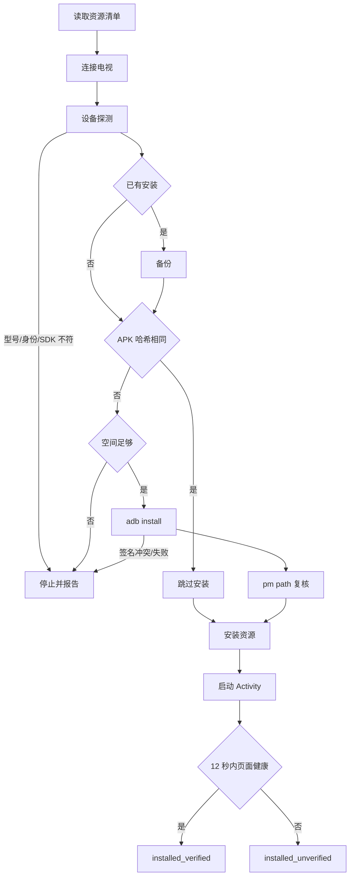
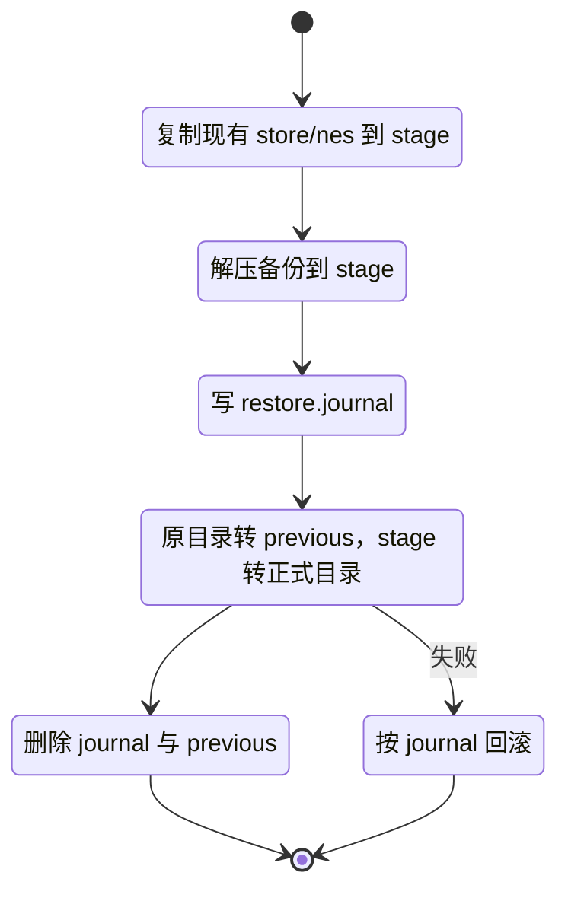
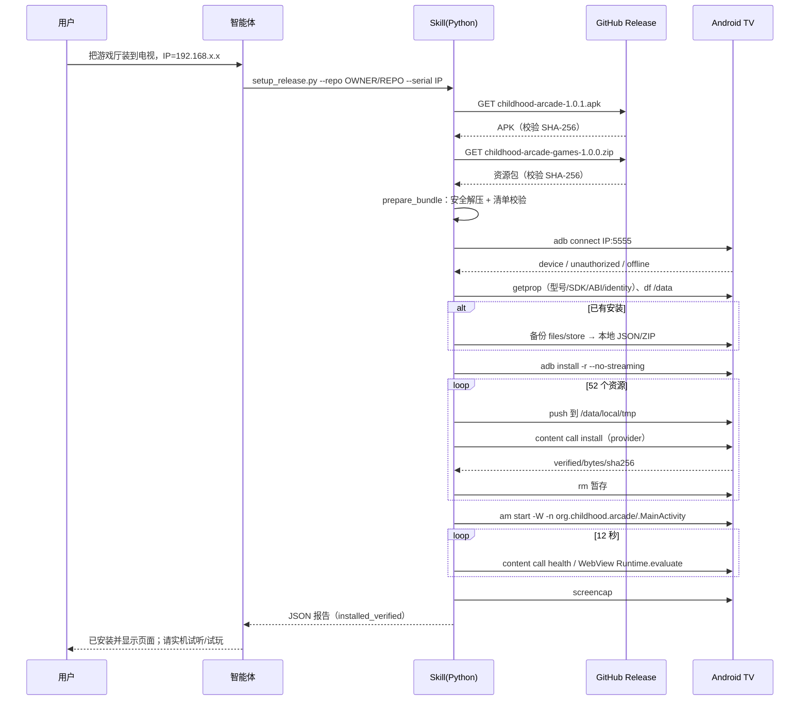
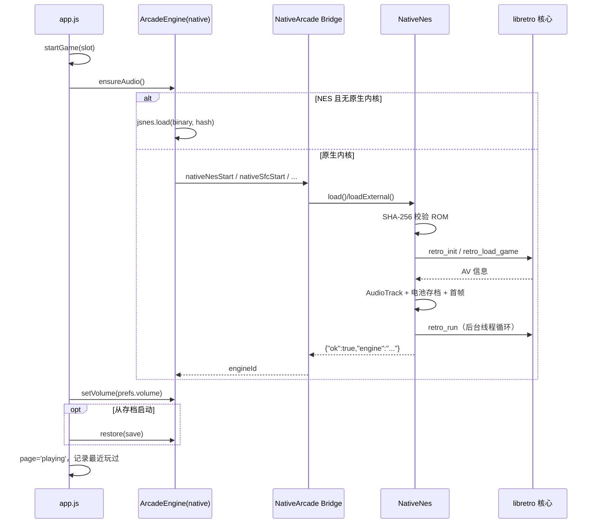
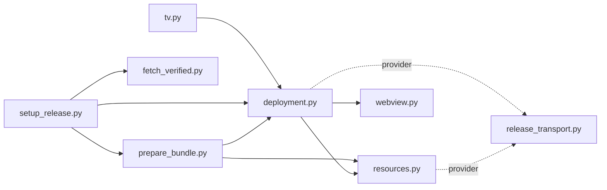

# 童年游戏厅（Childhood Arcade）Code Wiki

> 仓库：`https://github.com/fatherxu/childhood-arcade`
> 版本：1.0.1（APK `versionCode 21`）
> 文档定位：面向开发者的完整代码导读，覆盖架构、模块职责、关键类与函数、依赖关系、运行与构建方式、数据与安全模型。

| 文档信息 | 值 |
| --- | --- |
| 对应代码 | 以仓库当前 HEAD 为准 |
| APK 版本 | `versionName 1.0.1` / `versionCode 21` |
| 资源白名单 | 52 项（街机 23、GBA 12、MD 8、SFC 9） |
| 核对日期 | 2026-11-19 |
| 核对方式 | 源码走读 + `python3 -m unittest discover -s tests -v`（31 项通过） |

**文档约定**

- 正文中的代码块除特别注明外均为**节选或示意**，完整实现以对应的源码链接为准。
- 文件链接使用仓库相对路径（如 `../skills/...`），在 GitHub、VS Code、Typora 中均可直接跳转。
- “电视端”指运行 APK 的 Android TV / 电视盒子；“电脑端”指执行部署 Skill 的主机。
- 目录、文件名、状态码、JSON 字段名保持英文原样，不做翻译。
- 易变数字（版本号、资源数量、文件大小、测试数量）统一登记在 [1.1 关键事实与来源](#11-关键事实与来源)，升级时优先更新该表。
- 本文档只描述**当前仓库快照**；Release 构建输入的差异见 [15.2 仓库完整性](#152-仓库完整性)。

---

## 目录

1. [项目概览](#1-项目概览)
2. [仓库结构](#2-仓库结构)
3. [整体架构](#3-整体架构)
4. [电脑端部署 Skill（Python）](#4-电脑端部署-skillpython)
5. [电视端 Android 应用（Java）](#5-电视端-android-应用java)
6. [WebView 前端（JavaScript）](#6-webview-前端javascript)
7. [资源包、构建与第三方内核](#7-资源包构建与第三方内核)
8. [关键业务流程（时序）](#8-关键业务流程时序)
9. [依赖关系](#9-依赖关系)
10. [运行方式](#10-运行方式)
11. [配置与数据文件](#11-配置与数据文件)
12. [状态码与错误处理](#12-状态码与错误处理)
13. [安全模型](#13-安全模型)
14. [二次开发指南](#14-二次开发指南)
15. [已知限制与注意事项](#15-已知限制与注意事项)
16. [附录：速查表](#16-附录速查表)

---

## 1. 项目概览

「童年游戏厅」是一套**面向 Android 电视/电视盒子**的复古游戏前端，由三部分组成：

| 组成 | 运行位置 | 职责 |
| --- | --- | --- |
| **部署 Skill**（`skills/childhood-arcade-tv`） | 用户的电脑（智能体执行） | 下载、校验、准备、安装、更新、备份/恢复 |
| **APK**（`source/`） | Android 电视 | 游戏大厅 UI、手柄输入、模拟器内核调度、本地存档 |
| **游戏资源包** | 部署时传到电视 | ROM / BIOS 文件（约 375 MiB ZIP，解压约 495 MiB） |

核心特征：

- **一句话部署**：用户对电脑上的智能体说"把童年游戏厅装到电视上"，Skill 通过 ADB 完成全流程。
- **本地离线可玩**：部署完成后电视独立运行，不需要电脑常开。
- **五个平台**：FC/NES、街机（CPS1/2、NeoGeo、Konami、IGS PGM、Sega、Irem）、GBA、世嘉 MD、SFC。
- **多模拟器内核**：NES 使用 FCEUmm，街机使用 FB Alpha 2012，GBA 使用 mGBA，MD 使用 PicoDrive，SFC 使用 Snes9x 2005 / 2005 Plus。
- **严格的完整性校验**：SHA-256 贯穿下载、配置、传输、安装、启动验证全链路。
- **正式版无调试面**：APK 与 WebView 调试关闭，资源传输走受限 `ContentProvider`（`android.permission.DUMP` + 调用 UID 双重限制）。

技术栈：

| 层 | 技术 |
| --- | --- |
| 部署工具 | Python 3.9+（仅标准库）、Google ADB |
| TV 应用 | Java 8 语法、Android SDK（minSdk 23 / targetSdk 28）、JNA |
| 前端 | 原生 JavaScript（ES5 兼容）、Canvas、WebView、IndexedDB |
| 模拟器 | Libretro 核心（`.so`）+ JSNES（浏览器后备） |
| 构建 | aapt2、javac、d8、zipalign、apksigner |

### 1.1 关键事实与来源

下表是文档中最容易随版本变化的数字。升级时只需核对本表，并同步更新正文中的引用。

| 事实 | 当前值 | 事实来源 |
| --- | --- | --- |
| APK 版本 | `1.0.1` / `versionCode 21` | [version.json](../source/version.json) |
| APK 大小 | 17,284,226 字节（约 16.5 MiB） | [release.json](../skills/childhood-arcade-tv/assets/release.json) |
| 资源包大小 | 392,915,414 字节（约 374.7 MiB） | [release.json](../skills/childhood-arcade-tv/assets/release.json) |
| 资源包解压后 | 约 495 MiB | 发布记录 / 构建时的资源清单 |
| 游戏规模 | 179 款游戏、190 个版本 | `release-catalog.json`（Release 构建输入） |
| 资源白名单 | 52 项（街机 23、GBA 12、MD 8、SFC 9） | [deployment-resources.json](../source/app/src/main/assets/deployment-resources.json) |
| 部署单元测试 | 28 项，5 个测试文件 | [tests](../skills/childhood-arcade-tv/tests) |
| 默认传输协议 | `provider` | [release.json](../skills/childhood-arcade-tv/assets/release.json) |

> 说明：`release-catalog.json` 不在本仓库中，179/190 是发布包的事实；仓库内的 `catalog.js` 是空占位。
>
> **版本号口径**：Android APK 版本以 [version.json](../source/version.json) 为唯一来源（当前 `1.0.1` / `versionCode 21`），构建时由 `build-production.py` 注入 Manifest；`source/package.json` 仅用于前端开发依赖；`index.html` 中的 `?v=` 是静态资源缓存参数，不是发布版本。

### 1.2 阅读路线

| 你的目标 | 建议阅读顺序 |
| --- | --- |
| 第一次接触项目 | [1 项目概览](#1-项目概览) → [2 仓库结构](#2-仓库结构) → [3 整体架构](#3-整体架构) → [10 运行方式](#10-运行方式) → [14 二次开发指南](#14-二次开发指南) |
| 维护电脑端部署工具 | [4 部署 Skill](#4-电脑端部署-skillpython) → [8 关键流程](#8-关键业务流程时序) → [12 状态码](#12-状态码与错误处理) → [16.6 故障排查](#166-故障排查-faq) |
| 开发电视端 / 前端 | [5 Android 应用](#5-电视端-android-应用java) → [6 WebView 前端](#6-webview-前端javascript) → [11 配置与数据文件](#11-配置与数据文件) → [16.4 支持矩阵](#164-平台内核与按键支持矩阵) |
| 构建与发布 | [7 资源包与构建](#7-资源包构建与第三方内核) → [8 关键流程](#8-关键业务流程时序) → [15 已知限制](#15-已知限制与注意事项) → [16.7 发布检查清单](#167-发布检查清单) |
| 排查线上问题 | [12 状态码](#12-状态码与错误处理) → [13 安全模型](#13-安全模型) → [15 已知限制](#15-已知限制与注意事项) → [16.6 故障排查](#166-故障排查-faq) |

---

## 2. 仓库结构

```text
childhood-arcade/
├── README.md                      # 用户视角：安装、更新、适配说明
├── docs/                          # 用户/运维文档（8 篇，含本文）
│   ├── CodeWiki.md                # 开发者代码导读（本文）
│   ├── 安装指南.md
│   ├── 工作原理.md
│   ├── 存档与更新指南.md
│   ├── 技术说明.md
│   ├── 部署流程.md
│   ├── 构建说明.md
│   └── 测试记录.md
├── skills/childhood-arcade-tv/    # 电脑端部署 Skill
│   ├── SKILL.md                   # 智能体操作指令（含状态码处理策略）
│   ├── agents/openai.yaml         # Skill 元信息（显示名、默认提示词）
│   ├── assets/release.json        # 固定版本/文件名/SHA-256/传输协议
│   ├── references/operations.md   # 正式版操作细则
│   ├── scripts/                   # 8 个 Python 脚本（入口 tv.py）
│   │   ├── tv.py
│   │   ├── deployment.py          # 核心：ADB 客户端 + 部署状态机
│   │   ├── setup_release.py       # 一键下载 + 准备 + 部署
│   │   ├── fetch_verified.py      # HTTPS + SHA-256 下载
│   │   ├── prepare_bundle.py      # 解包/校验/落配置
│   │   ├── resources.py           # 资源清单校验 + 逐项安装
│   │   ├── release_transport.py   # ContentProvider 传输协议
│   │   └── webview.py             # 极简 WebSocket 页面健康检查
│   └── tests/                     # 5 个 unittest 测试文件
└── source/                        # 应用代码审阅副本
    ├── app/src/main/
    │   ├── AndroidManifest.xml
    │   ├── java/org/childhood/arcade/
    │   │   ├── MainActivity.java        # Activity + WebView + JS Bridge + 输入
    │   │   ├── NativeNes.java           # Libretro 宿主（JNA/音频/GL）
    │   │   ├── DeploymentProvider.java  # 资源传输与备份恢复（ContentProvider）
    │   │   ├── ResourceTool.java        # app_process CLI 资源校验安装
    │   │   ├── ControllerDirections.java# 手柄方向死区/迟滞
    │   │   └── GbaSaveMemory.java       # GBA 存档内存扩容
    │   ├── assets/                      # WebView 前端
    │   │   ├── index.html
    │   │   ├── app.js                   # 单文件状态机 + 全部页面
    │   │   ├── library.js               # 工具库（哈希/目录/排序/备份校验）
    │   │   ├── engine.js                # JSNES 引擎
    │   │   ├── multi-engine.js          # iframe 外部内核适配
    │   │   ├── native-nes.js            # NativeArcade 桥接引擎
    │   │   ├── style.css
    │   │   ├── catalog.js               # 游戏目录（仓库内为空占位）
    │   │   └── deployment-resources.json# APK 内资源白名单（52 项）
    │   └── res/drawable/                # 图标与横幅
    ├── scripts/build-production.py      # 无 Gradle 的生产构建脚本
    ├── third_party/                     # 5 个内核源码归档（tar.gz）
    ├── licenses/                        # 第三方许可证
    ├── *_CORE_ORIGIN.json               # 各内核来源与哈希固定
    ├── package.json / package-lock.json # 前端开发依赖（jsnes、playwright 等）
    ├── LICENSE / THIRD_PARTY_NOTICES.md
    └── 源码范围与构建状态.md
```

> **重要说明：本仓库是"代码审阅副本"**。以下内容未纳入仓库，真实存在于 Release 的构建输入 ZIP 中：
> `assets/vendor/`（jsnes、polyfills）、`assets/arcade|gba|md|sfc/player.html` 外部内核页面、`assets/fonts/`、`app/libs/jna-5.13.0.jar`、`app/src/main/jniLibs/*.so`、`release-catalog.json`、前端开发脚本 `scripts/serve.cjs` 与 `tests/`。
> 因此直接执行 `build-production.py` 与 `npm start` 需要先补齐这些文件。

---

## 3. 整体架构

### 3.1 三层拓扑

```text
┌───────────────────── 电脑（智能体 + Python） ─────────────────────┐
│  SKILL.md  ──>  tv.py / setup_release.py                         │
│      │                                                            │
│      ├─ fetch_verified.py ──HTTPS──> GitHub Releases              │
│      ├─ prepare_bundle.py ──解包──> ~/.config/childhood-arcade    │
│      ├─ resources.py      ──清单校验──┐                           │
│      └─ deployment.py / release_transport.py / webview.py         │
└───────────────────────────────┬───────────────────────────────────┘
                                │ ADB (TCP 5555 / USB)
┌───────────────────────────────▼───────────────────────────────────┐
│                    Android 电视（APK）                             │
│  MainActivity ── WebView(assets/index.html + app.js)               │
│      │                │                                            │
│      │                ├─ NativeArcade JS Bridge                    │
│      │                └─ engine.js(jsnes) / multi-engine.js(iframe)│
│      ├─ NativeNes ── JNA ──> libfceumm / libarcade / libmgba ...   │
│      ├─ DeploymentProvider ── content:// 传输 + 备份恢复           │
│      └─ files/store/*.json  ── 存档/设置/收藏                      │
└────────────────────────────────────────────────────────────────────┘
```

### 3.2 双端设计原则

1. **电脑只负责"搬运与校验"**：Skill 不参与游戏运行；不扫描网络、不自动选择设备。
2. **电视端自包含**：所有 UI、内核、存档都在本地；前端与原生通过固定 JS Bridge 通信。
3. **校验链闭合**：`release.json` → 下载校验 → 本地 APK/资源包校验 → 设备端资源白名单 + 逐文件 SHA-256 → 启动后页面健康状态确认。
4. **失败即停**：签名冲突、备份失败、设备身份变化、空间不足等场景一律停止，绝不自动卸载或清数据。

### 3.3 引擎选择矩阵

| 平台 | 系统标识 | 原生内核 | engineId | 前端后备 |
| --- | --- | --- | --- | --- |
| FC/NES | `nes` | `libfceumm.so` | `fceumm-native-81ebd3e72d96` | JSNES 2.1.0 |
| 街机 | `neogeo/cps1/cps2/konami/pgm/sega/irem` | `libarcade.so`（FB Alpha 2012） | `fba2012-native-749e6f6079e0` | iframe `arcade/player.html`（FBNeo） |
| GBA | `gba` | `libmgba.so` | `mgba-native-a976a807a7bd` | iframe `gba/player.html` |
| MD | `md` | `libpicodrive.so` | `picodrive-native-c1cc15edda64` | iframe `md/player.html` |
| SFC | `sfc` | `libsnes9x2005plus.so` | `snes9x2005plus-native-ada4dbf17de5` | iframe `sfc/player.html` |
| SFC（星之卡比） | `sfc` | `libsnes9x2005.so` | `snes9x2005-native-7e15337d8caa` | 同上 |

---

## 4. 电脑端部署 Skill（Python）

目录：[skills/childhood-arcade-tv](../skills/childhood-arcade-tv)

### 4.1 入口与命令面

[scripts/tv.py](../skills/childhood-arcade-tv/scripts/tv.py) 只有 5 行，直接转调 `deployment.main()`：

```python
from deployment import main
if __name__ == "__main__":
    raise SystemExit(main())
```

[deployment.py](../skills/childhood-arcade-tv/scripts/deployment.py) 的 `main()` 定义命令：

| 子命令 | 作用 | 关键参数 |
| --- | --- | --- |
| `configure` | 写入本地配置（APK 路径+哈希、资源清单、传输协议、型号绑定） | `--apk --sha256 --game-pack-manifest --expected-model --transport --forget-target` |
| `status` | 只读查看本地配置 | — |
| `deploy` | 连接电视 → 校验 → 备份 → 安装 → 推资源 → 启动验证 | `--serial` |
| `install` | 与 deploy 相同流程（可临时指定 APK） | `--serial --apk` |
| `doctor` | 只读检查设备（连接 + probe） | `--serial` |
| `probe` | 读取设备信息 | `--serial` |
| `backup` | 导出存档 ZIP | `--serial --output` |
| `restore` | 恢复存档 ZIP（仅 provider） | `--serial --input` |

全局参数：

- `--home`：配置目录，默认 `~/.config/childhood-arcade`，可被环境变量 `ARCADE_DEPLOY_HOME` 覆盖。
- `--adb`：ADB 可执行文件路径，优先级 `--adb` > `ARCADE_ADB` > 配置 `adb` > `shutil.which('adb')`。
- `--serial`：设备地址（IPv4 自动补 `:5555`）。

执行结果：**stdout 输出 JSON 报告**，stderr 输出阶段进度；报告同时写入 `home/reports/<run_id>.json`。退出码：`0` 成功、`2` 一般失败、`3` 已安装但页面未验证。

### 4.2 核心数据结构

```python
class DeploymentError(Exception):
    def __init__(self, status, message, **details):
        self.status, self.details = status, details
```

所有可预期失败都抛出该异常，`status` 即对智能体的可执行指令（详见[第 12 节](#12-状态码与错误处理)）。

### 4.3 关键函数

| 函数 | 说明 |
| --- | --- |
| [`atomic_json(path, value)`](../skills/childhood-arcade-tv/scripts/deployment.py#L31) | 临时文件 + `fsync` + `Path.replace` 原子替换；权限 `0600`；失败自动清理 |
| [`read_config(home)`](../skills/childhood-arcade-tv/scripts/deployment.py#L47) | 读 `deployment.json`，缺失时返回 `{'schema': 1}` |
| [`selected_serial(value)`](../skills/childhood-arcade-tv/scripts/deployment.py#L52) | 规范化地址：IPv4→`:5555`；校验端口 1–65535；拒绝 `-s`、`host;cmd` 等注入形态；空值 → `needs_target` |
| [`artifact(path, expected)`](../skills/childhood-arcade-tv/scripts/deployment.py#L73) | 校验 APK：扩展名、存在性、SHA-256、ZIP 必须含 `AndroidManifest.xml`/`classes.dex`/`assets/index.html`；计算 `required_free_bytes` |
| [`free_bytes(output, kilobytes)`](../skills/childhood-arcade-tv/scripts/deployment.py#L93) | 兼容新旧 `df` 输出的可用空间解析 |
| [`deploy(home, config, client, apk, report, announce)`](../skills/childhood-arcade-tv/scripts/deployment.py#L220) | 部署主状态机（见下） |
| [`main(argv)`](../skills/childhood-arcade-tv/scripts/deployment.py#L318) | 参数解析、依赖装配、异常收敛、报告落盘 |

`artifact()` 的空间估算：

```python
required_free_bytes = max(32 MiB, expanded_size * 2 + apk_size * 3)
```

### 4.4 `Client`：ADB 客户端

```python
class Client:
    def __init__(self, adb, serial)
    def run(args, timeout=12, allow_failure=False, binary=False)
    def shell(*args, **kwargs)
    def connect()
    def probe()
    def backup(path)
    def page()
```

- **`run`**：`subprocess.run` 包装；超时 → `connection_timeout`；`OSError` → `adb_unavailable`；返回码非 0 时解析 `unauthorized` → `needs_authorization`，否则 `adb_failed`。
- **`connect`**：`host:port` 先 `adb connect`；再 `get-state`；`device` 即成功；`unauthorized`/`failed to authenticate` → `needs_authorization`；`offline` → `device_offline`；其余 → `network_unreachable`（提示检查 IP、ADB 开关、VPN 局域网互通）。
- **`probe`**：读取
  `ro.build.version.sdk`、`ro.product.model`、`ro.product.device`、`ro.serialno`/`ro.boot.serialno`、`settings get secure android_id`；
  设备身份 `identity = sha256(json([model, device] + stable_ids))`；
  `df -k /data`（失败回退 `df /data`）得到 `free_bytes`。
- **`backup`**：
  - `provider` 模式 → `release_transport.backup()`（正式版）。
  - `legacy` 模式 → `run-as <pkg> ls files/store` + 逐个 `cat`，仅接受白名单文件名（`prefs`/`slot:*`/`battery:*`），写入 JSON（`0600`）。
- **`page`**：
  - `provider` 模式 → `release_transport.call(self, "health")`。
  - `legacy` 模式 → `ps -A` 精确匹配进程名（不信任小米 `pidof` 返回值）→ `adb forward tcp:0 localabstract:webview_devtools_remote_<pid>` → `http://127.0.0.1:<port>/json/list` → [webview.page_health](../skills/childhood-arcade-tv/scripts/webview.py) 通过 WebSocket 执行固定表达式。

### 4.5 `deploy()` 状态机

```text
读资源清单 (read_pack)
  └─> 连接电视 (connect)
      └─> 设备探测 (probe)
          ├─ 型号不符            -> wrong_model
          ├─ 身份与绑定不一致    -> target_changed
          ├─ SDK < 23            -> unsupported_android
          └─ 保存 target 到配置
              └─> 已有安装？
                  ├─ 是 -> backup()（失败则 backup_unavailable，停止）
                  └─ 否 -> 跳过备份
                      └─> 电视 APK 哈希 == 目标？
                          ├─ 是 -> 跳过安装（install_skipped）
                          └─ 否 -> 检查空间
                              ├─ 不足 -> insufficient_space
                              └─ adb install --no-streaming --no-incremental -r
                                  ├─ 签名冲突 -> signature_conflict（不卸载）
                                  ├─ 空间不足 -> insufficient_space
                                  ├─ 用户限制 -> installation_restricted
                                  └─ 其他     -> installation_failed
                                      └─> pm path 复核
                                          └─> 逐项安装资源 install_pack()
                                              └─> am start -W -n <pkg>/.MainActivity
                                                  └─> 12 秒内轮询页面健康
                                                      ├─ ready + title + visible -> installed_verified
                                                      └─ 否则 -> installed_unverified（退出码 3）
                                                          └─> screencap 截图保存
```

同一流程的 Mermaid 视图（支持 Mermaid 的渲染器可直接展开）：



注意：`report['physical_gameplay_verified']` 与 `report['audio_listening_verified']` 始终为 `False`——**自动化不宣称实体手柄、声音、流畅度通过**。

### 4.6 下载与准备

- [fetch_verified.py](../skills/childhood-arcade-tv/scripts/fetch_verified.py)
  `download(url, destination, expected)`：
  强制 HTTPS（重定向也必须是 HTTPS）、大小上限 2 GiB、流式 SHA-256、临时文件原子替换、失败保留旧文件。
- [prepare_bundle.py](../skills/childhood-arcade-tv/scripts/prepare_bundle.py)
  `prepare(home, apk, apk_hash, archive, archive_hash)`：
  校验 APK 与 ZIP 哈希 → 安全解压（拒绝绝对路径、`..`、`\`、`:`、符号链接、重复项、>2 GiB、>5000 文件）→ 校验 `game-pack/manifest.json` → 解压目录按哈希命名并原子 `rename` → 写入配置。
- [setup_release.py](../skills/childhood-arcade-tv/scripts/setup_release.py)
  `setup(descriptor, home, repository)`：
  校验 `OWNER/REPO` 与 tag → 拼接 `https://github.com/<repo>/releases/download/<tag>/<filename>` → 分别下载 APK 与游戏包到 `home/downloads/<sha256>-arcade.apk|game-pack.zip` → `prepare()` → 写入 `transport`。
  `main()` 在提供 `--serial` 时直接转调 `deployment.main(['deploy', '--serial', ...])`。

- [assets/release.json](../skills/childhood-arcade-tv/assets/release.json) 固定：

```json
{
  "schema": 1,
  "version": "1.0.1", "tag": "v1.0.1", "transport": "provider",
  "apk": { "filename": "childhood-arcade-1.0.1.apk", "sha256": "94ee…5e0a", "bytes": 17284226 },
  "game_pack": { "tag": "v1.0.0", "filename": "childhood-arcade-games-1.0.0.zip", "sha256": "d962…5c02", "bytes": 392915414 },
  "repository": "fatherxu/childhood-arcade"
}
```

`setup_release.py` 也支持 `--release-json` 指定自定义清单；`schema` 必须为 `1`。

### 4.7 资源清单与安装

[resources.py](../skills/childhood-arcade-tv/scripts/resources.py)：

| 函数 | 说明 |
| --- | --- |
| `read_pack(path)` | 校验 `schema==1`、文件列表非空；名称必须匹配 `[a-z0-9-]{1,60}\.(zip\|gba\|md\|sfc)`；路径必须相对且位于清单目录内；`0 < bytes ≤ 256 MiB`；逐文件 SHA-256；返回带 `source` 绝对路径的条目 |
| `resource_tool(client, package, apk_path, args)` | provider → `release_transport.call('verify'/'install')`；legacy → `run-as <pkg> /system/bin/sh -c "CLASSPATH=<apk> app_process /system/bin org.childhood.arcade.ResourceTool …"`，解析 `RESOURCE_JSON ` 行 |
| `install_pack(client, package, entries, announce, report)` | 先全量 `verify`；若目标已存在但哈希不同 → 报错并保留旧文件；计算剩余空间需求（总和 + 最大单文件 + 16 MiB）；逐个 `adb push` 到 `/data/local/tmp/childhood-arcade-<sha256>.zip` → `install` → 复核 → `rm` 暂存 |

支持断点续传式重跑：已校验通过的文件标记 `already_verified` 并跳过。

### 4.8 正式版传输协议

[release_transport.py](../skills/childhood-arcade-tv/scripts/release_transport.py)

```text
AUTH = content://org.childhood.arcade.deployment
```

- `call(client, method, arg=None)`：执行 `content call --uri <AUTH> --method <method> [--arg <arg>]`，从输出中正则提取 `result=<Base64>`，解码 JSON，`error` 字段转为异常。
- `backup(client, path)`：`am force-stop` → `content read --uri <AUTH>/backup`（二进制 ZIP）→ 校验 ZIP 条目白名单与 256 MiB 上限 → 强制后缀 `.zip`、权限 `0600`。
- `restore(client, path)`：本地先做同样的 ZIP 白名单/大小/完整性校验 → SHA-256 作为事务标识 → push 到 `/data/local/tmp/childhood-arcade-backup-<digest>.zip` → `force-stop` → `call('restore', digest)` → 清理暂存。

备份白名单（两端一致）：

```text
store/prefs.json
store/slot:[a-f0-9]{64}:[0-3].json
store/battery:[a-f0-9]{64}.json
nes/[a-f0-9]{64}.srm
```

### 4.9 页面健康检查

- **provider 模式（正式版）**：直接 `content call --method health`，由 `DeploymentProvider` 返回 APK 内写入的健康快照（超过 5 秒视为过期）。
- **legacy 模式**：走 DevTools 协议，由 [webview.py](../skills/childhood-arcade-tv/scripts/webview.py) 手写最小 WebSocket 客户端（无第三方依赖）：

1. 校验 `ws://` 且主机为 `localhost/127.0.0.1`、端口等于本次 `adb forward` 端口。
2. 完成 HTTP Upgrade 握手并校验 `Sec-WebSocket-Accept`。
3. 发送 `Runtime.evaluate`，执行固定表达式：

```js
(function(){
  var a = window.Arcade;
  return {
    title: document.title,
    ready: !!a,
    state: a ? a.getState() : null,
    catalogCount: window.GAME_CATALOG ? window.GAME_CATALOG.length : 0,
    visible: document.visibilityState,
    bodyText: document.body.innerText.slice(0, 200)
  };
})()
```

4. 解析分片帧、处理 ping/pong 与关闭帧；响应上限 1 MiB。
5. HTTP 请求显式使用空 `ProxyHandler`，避免系统代理干扰本机回环地址。

### 4.10 测试

[tests/](../skills/childhood-arcade-tv/tests) 覆盖了安全关键路径：

| 测试文件 | 覆盖点 |
| --- | --- |
| `test_deployment.py` | 目标设备变更、型号不符、SDK 过低、空间不足、备份失败、签名冲突不卸载、先备份后安装、全新安装不要求存档目录、页面未验证、未授权不发安装命令、网络错误状态、资源清单校验失败不改配置、APK 哈希失败不下发 ADB、pending_serial 优先、缺失目标不自动选设备、新旧 df 格式、备份排除 ROM 且不覆盖旧备份、精确进程匹配 |
| `test_prepare_bundle.py` | 复用已解压包、哈希失败不改配置、路径穿越（POSIX/Windows）、资源篡改拒绝 |
| `test_release_transport.py` | provider 结果解析、错误传播、ZIP 白名单 |
| `test_setup_release.py` | 完整下载准备流程、URL 缺失时配置不变 |
| `test_fetch_verified.py` | 哈希失败保留旧文件、拒绝 HTTP |

运行：

```sh
cd skills/childhood-arcade-tv
python3 -m unittest discover -s tests -v
```

---

## 5. 电视端 Android 应用（Java）

### 5.1 `MainActivity`：载体与调度中枢

文件：[MainActivity.java](../source/app/src/main/java/org/childhood/arcade/MainActivity.java)

职责：全屏 Activity、创建 WebView、注册 JS Bridge、分发按键/摇杆事件、管理本地存档目录、处理文件选择与备份导出。

#### 生命周期

```text
onCreate
 ├─ FLAG_KEEP_SCREEN_ON + hideSystemUI()
 ├─ storeDir = filesDir/store；若缺失且存在 store.previous → 重命名恢复
 ├─ WebView.setWebContentsDebuggingEnabled(false)  // 正式版关闭调试
 ├─ 清空 deployment SharedPreferences 的 health，用于"新鲜度"判断
 ├─ 创建 WebView + WebSettings
 ├─ addJavascriptInterface(new Bridge(), "NativeArcade")
 ├─ setWebViewClient(...)  // appassets 资源映射 + 外网拦截 + 页面加载标记
 ├─ setWebChromeClient(...) // 文件选择器
 ├─ setContentView(FrameLayout(root))
 ├─ nativeNes = new NativeNes(this, root)
 ├─ loadUrl("https://appassets.androidplatform.net/assets/index.html")
 ├─ 每秒 evaluateJavascript 健康表达式 → 写入 SharedPreferences
 └─ 注册 InputManager.InputDeviceListener
onPause     → nativeNes.pause() + Arcade.lifecyclePause()
onDestroy   → nativeNes.close() + 注销监听 + 销毁 WebView
```

#### WebView 安全配置

| 设置 | 值 | 原因 |
| --- | --- | --- |
| `setJavaScriptEnabled` | `true` | 前端运行必需 |
| `setDomStorageEnabled` / `setDatabaseEnabled` | `true` | IndexedDB 兜底存储 |
| `setAllowFileAccess` / `setAllowContentAccess` | `true` | `file:///android_asset/` 与备份文件 |
| `setAllowFileAccessFromFileURLs` | **`false`** | 禁止 file 源跨域读取 |
| `setAllowUniversalAccessFromFileURLs` | **`false`** | 禁止 file 源访问任意网络 |
| `setMediaPlaybackRequiresUserGesture` | `false` | 自动播放音频 |

#### 请求拦截

`shouldInterceptRequest` 将 `https://appassets.androidplatform.net/assets/<path>` 映射到 APK 内 `assets/<path>`：

- 拒绝包含 `..` 或以 `/` 开头的路径；
- 按扩展名设置 MIME（js/css/html/wasm/png/ttf），文本类使用 UTF-8；
- 其他 `http(s)` 请求一律返回空响应（应用离线自包含）。

`shouldOverrideUrlLoading` 仅允许 `file:///android_asset/` 与 `appassets` 前缀。

#### 输入分发

```java
dispatchKeyEvent(KeyEvent e)
dispatchGenericMotionEvent(MotionEvent e)
```

- 音量键直接交给系统。
- 处理键码：返回、方向、确定、菜单、`A/B/X/Y/L1/R1` 等。
- `gamepad(event)` 判断来源是否为 `SOURCE_GAMEPAD` / `SOURCE_JOYSTICK`。
- `player(deviceId)` 分配 1/2 号玩家（每个设备最多两人），并通过 `Arcade.nativeRegister(id, player)` 同步给前端。
- 原生游戏运行中 → `nativeNes.button(player, button, down)`；否则 → `Arcade.nativeKey(...)` 走 UI 导航。
- 摇杆/十字键在 `dispatchGenericMotionEvent` 中经 [ControllerDirections.update](../source/app/src/main/java/org/childhood/arcade/ControllerDirections.java) 转换，避免 WebView 抢先消费。

`nesButton(int code)` 做了平台差异化映射：

- GBA：`102/104 → 10`，`103/105 → 11`（L/R）。
- 街机/MD/SFC：`99 → 8`（SELECT），`100 → 9`（START），`102/104 → 10`，`103/105 → 11`。
- 通用：`19/20/21/22 → 4/5/6/7`（方向），`96/100 → 0`，`97/99 → 1`，`108 → 3`，`109 → 2`。

#### `Bridge`：JS ↔ 原生接口

| 方法 | 说明 |
| --- | --- |
| `nativeNesAvailable()` | `nativeLibraryDir/libfceumm.so` 是否存在 |
| `nativeNesStart(data, hash)` | Base64 NES ROM 载入原生内核 |
| `nativeSfcStart/nativeMdStart/nativeGbaStart/nativeArcadeStart(name, hash)` | 按平台载入外部 ROM |
| `nativeNesPause/Resume/Close/Button/Release/Volume/Bounds` | 播放控制 |
| `nativeNesSnapshot/Restore` | Libretro 即时存档 |
| `nativeNesImage()` | 当前帧 PNG data URL |
| `nativeNesStats()` | 运行统计 JSON |
| `readAsset(path)` | 仅允许 `roms/[a-z0-9-]+\.nes`，上限 8 MiB |
| `readStore/writeStore/listStoreKeys` | 键名校验 `[a-z0-9:_-]{1,160}`；单值上限 32 MiB；写入包在 `{"value":…}` 中交给 `AtomicFile`；读取异常返回 `{"__readError":true}` |
| `writeBatch(json)` | 批量恢复：≤1000 条；写 `store.stage` → 原目录改名 `store.previous` → stage 提交 → 失败回滚，成功后删除 `store.previous` |
| `finishApp()` | 主线程 `finish()` |
| `exportBackup(json)` | 上限 50 MiB；触发 `ACTION_CREATE_DOCUMENT`，标题「童年游戏厅_存档备份.json」 |

存储写入使用 `AtomicFile`；`writeBatch` 是**目录级事务**，保证恢复失败时原存档不变。

### 5.2 `NativeNes`：Libretro 宿主

文件：[NativeNes.java](../source/app/src/main/java/org/childhood/arcade/NativeNes.java)

这是全项目最复杂的类：通过 JNA 直接调用 Libretro 核心的 C ABI，自行管理帧循环、音频输出、OpenGL 渲染与存档。

#### 核心常量与状态

```java
public static final String SFC_FAST_ENGINE = "snes9x2005-native-7e15337d8caa";
public static final String SFC_ENGINE      = "snes9x2005plus-native-ada4dbf17de5";
public static final String MD_ENGINE       = "picodrive-native-c1cc15edda64";
public static final String GBA_ENGINE      = "mgba-native-a976a807a7bd";
public static final String ARCADE_ENGINE   = "fba2012-native-749e6f6079e0";
public static final String ENGINE          = "fceumm-native-81ebd3e72d96";
```

#### 回调接口（JNA `Callback`）

| 接口 | 对应 Libretro 回调 | 实现要点 |
| --- | --- | --- |
| `Environment` | `retro_environment` | 支持：日志(27)、允许丢帧(3)、像素格式(10)、系统目录(9/30/31)、核心选项(15/16)、变量/输入描述(11/35/37)、选项变更(17)。对 PicoDrive 强制 `6 button pad`，对 NeoGeo 强制 `MVS` |
| `Video` | `retro_video_refresh` | 校验尺寸 ≤1024；按 pitch 拷贝；RGB565（2B）/ARGB8888（4B）；触发 `GLSurfaceView.requestRender()` |
| `Sample` | `retro_audio_sample` | 单帧立体声写入 `AudioTrack` |
| `AudioBatch` | `retro_audio_sample_batch` | 批量写音频，帧数上限 16384 |
| `Poll` | `retro_input_poll` | 计算输入延迟（`inputLatencyMs`） |
| `Input` | `retro_input_state` | 从 `AtomicIntegerArray buttons` 读取按键位掩码；`id==256` 返回整包掩码 |
| `CoreLog` | 日志回调 | `level >= 2` 时写 `Log.w("ArcadeCore", …)` |

#### 载入流程

| 方法 | 说明 |
| --- | --- |
| `load(encoded, expected)` | NES：Base64 解码 → 8 MiB 上限 → SHA-256 比对 → 写入 `cache/running-game.nes` → `retro_load_game` |
| `loadExternal(name, expected, gba, md, sfc)` | 外部平台：名称正则（`.zip/.gba/.md/.sfc`）→ 文件存在性 + SHA-256 校验 → 读取 `files/<platform>/roms/<name>` → `retro_load_game`；SFC 仅当文件名恰为 `sfc-kirby-superstar.sfc` 时使用 `libsnes9x2005.so`，其余用 `libsnes9x2005plus.so`；SFC ROM 全程载入内存且限制 ≤16 MiB |
| `initLibrary()` | 设置 JNA 路径（`jna.boot.library.path`、`jna.nosys`、`jna.nounpack`），加载 `.so`，注册全部回调，缓存 `retro_run/serialize/unserialize/serialize_size` |
| `finishLoad(expected)` | 读取 AV 信息校验帧率 40–70、采样率 8k–96k；创建 `AudioTrack`；加载电池存档；跑一帧首图；`retro_set_controller_port_device(0..1, 1)` |
| `startThread()` | 启动名为 `Retro-native` 的线程 |

#### 运行循环

```java
Thread.setPriority(THREAD_PRIORITY_AUDIO)
period = 1e9 / fps
while (!stop) {
    if (!running) { sleep(3ms); continue; }
    retro_run(); frames++;
    if ((gba || md || sfc) && frames % 300 == 0) saveBattery();
    // 帧率补偿：落后超过一帧则重置基准，统计 lateFrames
    sleep(剩余时间);
}
```

#### 存档体系

| 类型 | 位置/格式 |
| --- | --- |
| NES 电池存档 | `files/nes/<hash>.srm`（原始字节 + `AtomicFile`） |
| GBA/MD/SFC 电池存档 | `files/store/battery:<hash>.json`，字段：`schema/format/hash/engine/bytes/sha256/data(Base64)` |
| 即时存档 | JSON：`{schema, engine, hash, frames, state:{format:"libretro-base64", data, bytes, sha256}}` |

- `snapshot()`：`retro_serialize`，大小限制 8 MiB。
- `restore(json)`：严格校验 `schema/engine/hash/format/sha256/bytes`；先序列化当前进度，反序列化失败则回滚并保留原进度。
- `saveHandheldBattery()` / `loadHandheldBattery()`：含引擎与哈希身份校验，`GbaSaveMemory` 处理 128 KiB 缓冲。

#### 视频渲染 `GameView`

内部类 `GameView extends GLSurfaceView`：

- GLES2，`RENDERMODE_WHEN_DIRTY`，`setPreserveEGLContextOnPause(true)`。
- 顶点着色器直通；片段着色器支持 RGB565 与 ARGB（`xrgb==1` 时交换 B/R）。
- `glTexImage2D` 分配 + `glTexSubImage2D` 局部更新；`presentedFrames` 统计实际呈现帧。

#### 其他 API

`resume()` / `pause()` / `close()` / `releaseAll()` / `button()` / `volume()` / `bounds()` / `image()` / `stats()` / `isRunning()/isGba()/isArcade()/isMd()/isSfc()`。

- GBA 为单人游戏：`button()` 对 `player != 1` 直接返回。
- 电池存档上限：NES/MD/SFC 内存 ≤1 MiB；GBA 经 `GbaSaveMemory` 固定 128 KiB；`battery:*.json` 文件 ≤1,500,000 字节，超限保留原文件并报错。

`stats()` 输出字段：`engine`、`reportedSaveBytes`、`running`、`loaded`、`frames`、`fps`、`targetFps`、`frameAndAudioMs`、`audioFrames`、`drawFrames`、`presentedFrames`、`presentationFps`、`inputLatencyMs`、`inputSamples`、`pixelFormat`、`audioPlayedFrames`、`lateFrames`、`sampleRate`、`buttons1`、`buttons2`、`error`。

按钮映射（`button(player, button, down)`）：

```java
MD          : {1,0,2,3,4,5,6,7,8,9,10,11}
Arcade/SFC  : {0,8,2,3,4,5,6,7,1,9,10,11}
GBA         : {8,0,2,3,4,5,6,7,1,9,10,11}
NES         : {8,0,2,3,4,5,6,7}
```

### 5.3 `DeploymentProvider`：无调试面的传输通道

文件：[DeploymentProvider.java](../source/app/src/main/java/org/childhood/arcade/DeploymentProvider.java)

- Authority：`org.childhood.arcade.deployment`。
- Manifest 声明 `android:exported="true"` + `android:permission="android.permission.DUMP"`。
- `shellOnly()`：调用 UID 必须是 `2000`（ADB shell）或 `0`（root），否则 `SecurityException`。

`call(method, arg, extras)` 支持：

| method | 行为 |
| --- | --- |
| `capabilities` | 返回 `{protocol: 1}` |
| `health` | 从 `deployment` SharedPreferences 读取 `health`，超过 5 秒视为过期 |
| `verify` | 按 `assets/deployment-resources.json` 白名单校验目标文件 |
| `install` | 从 `/data/local/tmp/childhood-arcade-<sha256>.zip` 复制 → 校验哈希 → 临时文件 rename 原子提交 |
| `restore` | 从 `/data/local/tmp/childhood-arcade-backup-<sha256>.zip` 恢复存档 |

资源落点：

```text
name.endsWith(".gba") -> files/gba/roms/<name>
name.endsWith(".md")  -> files/md/roms/<name>
name.endsWith(".sfc") -> files/sfc/roms/<name>
否则                   -> files/arcade/roms/<name>
```

备份：`openFile(uri)` 只允许 `content://…/backup` 且模式 `r`；动态生成 ZIP 后返回只读 FD。`query/insert/delete/update` 全部抛 `SecurityException`。

**恢复事务**（防断电，且为"叠加式"恢复）：

```text
1. 复制现有 store/、nes/ 到 restore.stage（备份未覆盖的文件会被保留）
2. 解压备份到 restore.stage（白名单、去重、≤1000 项、≤256 MiB）
3. 写 restore.journal（记录原目录是否存在）
4. 原目录 -> *.restore.previous；stage -> 正式目录
5. 删除 journal 与 previous
失败：按 journal 回滚；进程重启时 onCreate -> recoverRestore() 继续处理
```



### 5.4 `ResourceTool`：legacy 模式的资源 CLI

文件：[ResourceTool.java](../source/app/src/main/java/org/childhood/arcade/ResourceTool.java)

通过 `app_process` + `CLASSPATH=<apk>` 以应用 UID 运行，因此可访问 `files/`。

- 命令：`verify <name> <sha256>` / `install <source> <name> <sha256>`。
- 暂存路径必须位于 `/data/local/tmp/childhood-arcade-` 或 `/data/local/tmp/arcade-native-bench/roms/`。
- 单文件 ≤256 MiB，写入 `<name>.part` 后校验再 rename。
- 输出 `RESOURCE_JSON {...}`；异常时同样输出 JSON 并以退出码 2 结束。

### 5.5 辅助类

| 类 | 说明 |
| --- | --- |
| [ControllerDirections](../source/app/src/main/java/org/childhood/arcade/ControllerDirections.java) | 方向键二值化：按下阈值 `0.65`、释放阈值 `0.60`（迟滞），十字键阈值 `0.5`；输出 `[上, 下, 左, 右]`。注释说明 SHANWAN 手柄静止偏置可达 `-0.53` |
| [GbaSaveMemory](../source/app/src/main/java/org/childhood/arcade/GbaSaveMemory.java) | mGBA 固定按 `GBA_SIZE_FLASH1M`（128 KiB）分配存档；`expand()` 用 `0xFF` 填充，保证不截断既有存档 |

### 5.6 Manifest 摘要

```xml
package="org.childhood.arcade"
versionCode="21" versionName="1.0.1"
minSdkVersion="23" targetSdkVersion="28"
debuggable="false" allowBackup="false" usesCleartextTraffic="false"
isGame="true"
```

- `DeploymentProvider`：`exported=true` + `permission=android.permission.DUMP`。
- `MainActivity`：横屏、`singleTask`、`LAUNCHER` + `LEANBACK_LAUNCHER`。
- 非必需特性：触摸屏、Leanback、手柄。

---

## 6. WebView 前端（JavaScript）

前端为**无框架、单页、事件驱动**实现，须兼容 Android 6 自带的旧 WebView（ES5）。

### 6.1 脚本加载顺序

[index.html](../source/app/src/main/assets/index.html) 中的顺序具有强依赖：

```text
vendor/polyfills.min.js   (core-js, 仓库未含)
vendor/jsnes.min.js       (JSNES 2.1.0, 仓库未含)
catalog.js                (window.GAME_CATALOG)
library.js                (window.ArcadeLib)
engine.js                 (window.ArcadeEngine = JSNES 引擎)
multi-engine.js           (包装为 iframe 引擎)
native-nes.js             (再包装为原生引擎, 最终覆盖 window.ArcadeEngine)
app.js                    (应用主体)
```

### 6.2 `library.js`：通用工具

文件：[library.js](../source/app/src/main/assets/library.js)

| 导出 | 说明 |
| --- | --- |
| `normalize(s)` | 去空白及 `- _ , ，。·` 后转大写，用于中文名、俗称、版本搜索 |
| `matches(g, q)` | 标题 + aliases + version 的包含匹配 |
| `sha256(bytes)` | 纯 JS SHA-256 实现（用于 ROM/存档完整性） |
| `resolveHomeOrder(games, saved)` | 首页排序：用户保存顺序 + 经典默认顺序 + 其余游戏 |
| `sortHomeGames(list, all, saved)` | 按排序表稳定排序 |
| `moveHomeGame(order, id, index)` | 拖动/移动单个条目 |
| `validHomeOrder(value)` | 限制 ≤1000 项、`[a-z0-9-]{1,100}`、无重复 |
| `validateBackup(value)` | 校验 `schema==1`、`app=='childhood-arcade'`、≤1000 条、条目键白名单、prefs 范围、slot 身份、电池存档 |
| `validateBattery(v, hash, engine)` | 校验引擎 ID 前缀、格式、字节数与 SHA-256 |
| `isArcade/isHandheld/isMd/isSfc/isExternal` | 平台判定 |

经典默认顺序 `classicHomeOrder`：`contra`、`mario`、`battlecity`、`chipdale`…（共 25 条），未列出的游戏按目录顺序追加。

### 6.3 `engine.js`：JSNES 引擎

文件：[engine.js](../source/app/src/main/assets/engine.js)

```js
Engine.prototype.load(binary, hash)      // 创建 jsnes.NES，渲染 256×240
Engine.prototype.ensureAudio()           // AudioContext + ScriptProcessor(1024)
Engine.prototype.resume()/pause()        // requestAnimationFrame 循环，60fps 补偿
Engine.prototype.button(player, btn, down)
Engine.prototype.snapshot()/restore(save) // jsnes.toJSON/fromJSON，带回滚
Engine.prototype.setVolume(v)
Engine.prototype.thumbnail()             // Canvas dataURL
```

音频使用 32768 样本环形缓冲；`buffered > 30000` 时丢帧，防止延迟累积。存档标识固定 `engine: 'jsnes-2.1.0'`。

### 6.4 `multi-engine.js`：iframe 外部内核适配

文件：[multi-engine.js](../source/app/src/main/assets/multi-engine.js)

- `kind = 'nes'` 时完全代理 JSNES。
- 其他平台创建 `<iframe class="arcade-frame">`，按系统加载
  `arcade/player.html`、`gba/player.html`、`md/player.html`、`sfc/player.html`。
- 通过 `frame.contentWindow.ArcadePlayer` 约定接口：
  `start(game, battery)`、`pause()`、`resume()`、`snapshot()`、`restore(bytes)`、`image()`、`setVolume()`、`setFrames()`、`input(playerIndex, button, down)`、`dispose()`、`stats()`、`audio()`。
- 启动超时 120 秒；`generation` 计数保证切换游戏时旧加载被取消。
- 存档格式按平台：`fbneo-base64` / `mgba-base64` / `picodrive-base64` / `snes9x-base64`，并含 SHA-256 校验。
- `applyScale()` 支持原始比例与整数缩放（GBA 240×160，其他 320×240）。

### 6.5 `native-nes.js`：原生引擎桥接

文件：[native-nes.js](../source/app/src/main/assets/native-nes.js)

- 若 `NativeArcade.nativeNesAvailable()` 为假 → 回退到上一层 `multi-engine.js`（NES 最终走 JSNES）。
- 根据游戏类型调用 `nativeNesStart` / `nativeSfcStart` / `nativeMdStart` / `nativeGbaStart` / `nativeArcadeStart`。
- 每秒读取 `nativeNesStats()`，若出现 `error` 立即暂停并回调 `onError`。
- `syncBounds()` 把 Canvas 在 WebView 中的位置/尺寸传给原生 GL 视图。
- 兼容旧 JSNES 存档：检测 `save.engine === 'jsnes-2.1.0'` 时创建 legacy JSNES 实例继续运行旧进度，**不篡改存档标识**。
- `snapshot/restore` 直接透传 `NativeArcade`；`restore` 在校验 schema/engine/hash/format 后，还会检查 Base64、长度（≤12 MB 字符串）、状态字节数与 SHA-256。
- 旧 JSNES 存档若因原生内核缺失而无法继续，会保留原存档标识并在旧引擎中运行，不写入新格式。

### 6.6 `app.js`：应用主体

文件：[app.js](../source/app/src/main/assets/app.js)（约 51 KB，压缩风格书写）

#### 存储抽象 `Store`

| 方法 | native 模式 | 浏览器模式 |
| --- | --- | --- |
| `get(key)` | `NativeArcade.readStore` | IndexedDB `childhood-arcade/items` |
| `set(key, value)` | `NativeArcade.writeStore` | IndexedDB `put` |
| `batch(entries)` | `NativeArcade.writeBatch`（目录级事务） | 单事务多 put |
| `keys()` | `NativeArcade.listStoreKeys` | `openCursor` |

键空间：

```text
prefs                    设置（音量、收藏、最近、首页顺序、缩放、欢迎页）
custom                   用户导入的 NES 游戏列表
rom:<sha256>             导入的 NES ROM（Base64）
slot:<sha256>:0..3       即时存档（含截图、时间、标题）
battery:<sha256>         GBA/MD/SFC 电池存档
```

#### 状态机

```js
var state = {
  page: 'home',        // welcome | home | detail | search | settings | slots | loading | playing | organize
  tab: '全部游戏',
  query: '', players: '全部', genre: '全部',
  current: null,       // 当前游戏
  dialog: null, paused: false,
  slots: [], slotMode: 'save',
  loading: false, busy: false, blocked: false,
  focus: {},           // 每页焦点记忆
  orderDraft: null, orderSelected: null, orderMoving: false, dragOrder: null,
  custom: [],
  prefs: { volume:70, favorites:[], recent:[], welcome:false, scale:'original' }
};
```

#### 路由与渲染

`render(preferredFocus)` 是唯一渲染入口：

| page | 渲染函数 | 说明 |
| --- | --- | --- |
| `welcome` | `renderWelcome()` | 三步引导 |
| `home` | `renderHome()` | 平台 Tab（全部游戏/红白机/街机/GBA/MD/SFC/双人合作/我的收藏/最近玩过，按游戏库动态出现）+ 卡带网格 + 翻屏控件 |
| `detail` | `renderDetail()` | 封面、版本切换、继续存档、开始游戏、收藏、操作说明 |
| `search` | `renderSearch()` | 搜索框、人数/类型筛选、虚拟键盘、结果网格 |
| `settings` | `renderSettings()` | 画面比例、音量、操作说明、手柄检测、备份、导入、关于 |
| `slots` | `renderSlots()` | 4 个存档位（0=快速存档） |
| `organize` | `renderOrganize()` | 首页排序：拖拽 / 按钮 / 遥控器 |
| `loading` | 内联 | 外部内核加载中 |
| `playing` | 隐藏 `#app`，显示 `#play-screen` | 游戏画面 |

焦点管理：`focusKey()` / `focusMove()` / `keepVisible()`，支持方向键在网格中按几何距离移动。

#### 主要动作（`action()` 分发表）

| 动作 | 行为 |
| --- | --- |
| `tab` / `detail` / `search` / `settings` / `home` / `back` | 页面切换与返回 |
| `start` / `continue` | 开始游戏或读取指定存档启动 |
| `pause` / `resume` / `exit` | 暂停、继续、退出确认 |
| `save-menu` / `load-menu` / `slot` | 存档位操作（含覆盖确认） |
| `export` / `import-backup` | 导出/恢复备份（导入上限 50 MiB） |
| `import-games` | 导入 NES（`NES\x1a` 头校验、≤8 MiB、SHA-256 去重、JSNES 试跑 256×240 截图） |
| `favorite` | 收藏/取消收藏 |
| `volume` / `scale` | 设置 |
| `organize` / `order-select` / `order-shift` / `order-top` / `order-bottom` / `order-reset` / `order-save` / `order-cancel` | 首页排序 |
| `browse` | 首页翻屏 |
| `players` / `genre` / `type` / `delete-char` / `clear-query` / `clear-all` / `input` | 搜索筛选与软键盘输入 |
| `welcome-done` | 完成首次引导并写入 `prefs.welcome` |
| `help` / `controllers` / `about` | 说明弹窗 |
| `versions` | 同族游戏版本切换 |

#### 输入

- 键盘：`map1`（1P）与 `map2`（2P），方向 + `Z/X/C/V/B/N/Q/E` + `Enter/Shift`。
- Gamepad API：`pollGamepads()` 在浏览器预览模式使用；原生模式下由 Java `dispatchKeyEvent` 通过 `Arcade.nativeKey` 注入。
- `keyEvent()` 区分「游戏中」与「UI 导航」两种上下文；`uiKey()` 处理确认/返回。
- 失焦或页面隐藏自动暂停。

#### `window.Arcade` 对外 API

```js
window.Arcade = {
  keyboardEvent, storageError,
  nativeRegister(id, player), nativeKey(...), nativeDisconnected(id),
  lifecyclePause(), backupResult(ok),
  getState(),          // 供部署脚本健康检查
  engine, store
};
```

`getState()` 返回 `{page, paused, frames, game, dialog, busy, audio, system}`，是部署验收的核心依据。

### 6.7 `style.css`：视觉与平台兼容

文件：[style.css](../source/app/src/main/assets/style.css)

- CSS 变量：`--paper #f4ebd8`、`--ink #322018`、`--red #8e1835`、`--yellow #f4c331`、`--edge #c88917`。
- 卡带式 UI：边框、内阴影、螺丝装饰、像素化封面。
- 响应式：`@media(max-width: 800px)` 适配 720p 电视。
- `@supports not (display:grid)` 为 Android 6 旧 WebView 提供 flex 回退。
- `html.native-running` 使 WebView 背景透明，让底层原生 GL 视图透出；菜单仍浮在上层。
- 字体：`fonts/ui-bold.ttf`（Noto Sans SC 子集，仓库未含）。

---

## 7. 资源包、构建与第三方内核

### 7.1 APK 内资源白名单

[deployment-resources.json](../source/app/src/main/assets/deployment-resources.json) 是设备端唯一可信的资源清单，共 **52 项**：

| 平台 | 数量 | 示例 |
| --- | --- | --- |
| 街机（`.zip`） | 23 | `kof97.zip`、`kof98.zip`、`mslug.zip`、`neogeo.zip`、`pgm.zip` |
| GBA（`.gba`） | 12 | `pokemon-firered.gba`、`castlevania-aria.gba`、`fire-emblem7.gba` |
| MD（`.md`） | 8 | `sonic2.md`、`streets-of-rage2.md`、`gunstar-heroes.md` |
| SFC（`.sfc`） | 9 | `sfc-mario-world.sfc`、`sfc-kirby-superstar.sfc`、`sfc-super-metroid.sfc` |

每项含 `name`、`bytes`、`sha256`。设备端 `DeploymentProvider` 与 `ResourceTool` 都只接受此白名单内的文件。

> 文档中的「179 款游戏、190 个版本」来自发布目录 `release-catalog.json`；同一资源可对应多个版本条目，因此数量不同。本仓库 `catalog.js` 为空占位，实际目录由构建时注入。

### 7.2 构建脚本

[build-production.py](../source/scripts/build-production.py) 不依赖 Gradle：

```text
0. check-native-abis.py 校验 armeabi-v7a / arm64-v8a 原生库集合、ELF 架构与 SHA-256（native-abi-lock.json）
1. 复制 assets → build-production/assets
2. 从副本中删除 arcade/gba/md/sfc 以及 vendor/{fbneo,mgba,picodrive,snes9x}
   （正式 APK 不内置 iframe 播放器，外部平台依赖原生 .so）
3. 由 release-catalog.json 重新生成 catalog.js（仓库内该文件为空占位）
4. aapt2 compile --dir res -o resources.zip
5. aapt2 link -o base.apk -I android.jar --manifest … -A assets … --auto-add-overlay
   （`--version-code` / `--version-name` / `--replace-version` 由 version.json 注入）
6. javac -encoding UTF-8 -source 8 -target 8 -bootclasspath android.jar -cp jna-5.13.0.jar
7. jar 打包 classes → d8 --min-api 23 --lib android.jar（classes.jar + JNA）
8. 将 classes.dex 与 jniLibs/**/*.so 注入 APK
9. zipalign -f -p 4
10. apksigner sign（`java -jar tools/lib/apksigner.jar`，密码仅经环境变量 ARCADE_SIGNING_PASSWORD）+ verify
11. 输出 childhood-arcade-<version>.apk 及其字节数、SHA-256，并生成 update.json（应用内更新清单）
```

应用内更新由 [AppUpdates.java](../source/app/src/main/java/org/childhood/arcade/AppUpdates.java) 负责：仅允许 HTTPS、限制跳转与大小、校验 SHA-256/包名/versionCode/签名。客户端补充 `assets/isrg-root-x1.pem` 并在系统校验证书链失败时回退到该根证书，以兼容未内置 ISRG Root X1 的 Android 7.0 及更早电视。

签名配置 JSON：`{ "keystore": "...", "alias": "...", "password": "..." }`，属于机密，不入库。

### 7.3 第三方内核来源

| 文件 | 内容 |
| --- | --- |
| [NATIVE_CORE_ORIGIN.json](../source/NATIVE_CORE_ORIGIN.json) | FCEUmm（GPL-2.0），commit `e0f3086`，JNA 5.13.0 |
| [ARCADE_CORE_ORIGIN.json](../source/ARCADE_CORE_ORIGIN.json) | FB Alpha 2012（非商业），commit `0ce3153` |
| [GBA_CORE_ORIGIN.json](../source/GBA_CORE_ORIGIN.json) | mGBA 0.11-212（MPL-2.0） |
| [MD_CORE_ORIGIN.json](../source/MD_CORE_ORIGIN.json) | PicoDrive（非商业） |
| [SFC_CORE_ORIGIN.json](../source/SFC_CORE_ORIGIN.json) | Snes9x 2005 / 2005 Plus（非商业） |

所有内核均固定：

- `archiveURL` / `archiveSha256`：官方 buildbot 归档
- `nativeSha256`：解压后 `.so` 哈希
- `engineId`：写入存档，用于跨版本兼容判断

### 7.4 许可证要点

- 项目原创代码：MIT（[LICENSE](../source/LICENSE)）。
- 前端：JSNES（Apache-2.0）、core-js（MIT）、Noto Sans SC（OFL）。
- 原生：FCEUmm（GPL-2.0，组合产物需遵守 GPL）、mGBA（MPL-2.0）、FB Alpha/PicoDrive/Snes9x（**非商业条款**）。
- 游戏 ROM/BIOS：不纳入开源许可，仓库与 Release 源码包均不包含。

详见 [THIRD_PARTY_NOTICES.md](../source/THIRD_PARTY_NOTICES.md)。

---

## 8. 关键业务流程（时序）

### 8.1 一句话部署



### 8.2 启动游戏



### 8.3 存档保存与恢复

```text
保存：
  app.js saveSlot(n)
    → engine.snapshot()
        NES: jsnes.toJSON()
        其他: content call → retro_serialize → Base64 + SHA-256
    → 附加 time / image(thumbnail) / title / slot
    → Store.set('slot:<hash>:<n>')
        native: NativeArcade.writeStore → AtomicFile
        浏览器: IndexedDB put

读取：
  app.js chooseSlot(n) → engine.restore(save)
    校验 schema / engine / hash / format / sha256 / bytes
    失败：保留当前进度并报错
    成功：继续渲染循环
```

### 8.4 备份 → 恢复（provider）

```text
备份：
  tv.py backup
    → Client.connect + probe（核对设备身份）
    → release_transport.backup
        am force-stop
        content read content://org.childhood.arcade.deployment/backup
        DeploymentProvider.openFile → 动态 ZIP（store/ + nes/ 白名单）
        本地校验 ZIP → 写 <output>.zip（0600）

恢复：
  tv.py restore --input backup.zip
    → 本地 ZIP 白名单/大小/完整性校验
    → push /data/local/tmp/childhood-arcade-backup-<sha256>.zip
    → am force-stop
    → content call --method restore --arg <sha256>
        stage 复制 → journal → 原子替换 → 失败回滚
    → rm 暂存
```

---

## 9. 依赖关系

### 9.1 模块依赖图

```text
tests/
  ├─ test_deployment.py      → deployment
  ├─ test_prepare_bundle.py  → prepare_bundle → deployment, resources
  ├─ test_setup_release.py   → setup_release → deployment, fetch_verified, prepare_bundle
  ├─ test_release_transport.py → release_transport
  └─ test_fetch_verified.py  → fetch_verified

setup_release.py → fetch_verified, prepare_bundle, deployment
deployment.py    → webview, resources
                 → release_transport（provider 模式下延迟导入）
resources.py     → release_transport（provider 模式下延迟导入）
prepare_bundle.py→ deployment, resources
tv.py            → deployment
```



### 9.2 Python 依赖

全部为**标准库**，无 `pip` 依赖：

`argparse` `base64` `datetime` `hashlib` `ipaddress` `json` `os` `pathlib` `re` `shutil` `socket` `struct` `subprocess` `sys` `tempfile` `time` `urllib` `uuid` `zipfile`

外部可执行文件：**Google Android Platform Tools（adb）**。

### 9.3 Android / 前端依赖

| 依赖 | 版本/来源 | 用途 |
| --- | --- | --- |
| JNA | 5.13.0（Maven AAR） | 调用 Libretro `.so` |
| FCEUmm | commit `e0f3086`，GPL-2.0 | NES 原生 |
| FB Alpha 2012 | commit `0ce3153`，非商业 | 街机原生 |
| mGBA | 0.11-212-7a12d6d，MPL-2.0 | GBA 原生 |
| PicoDrive | 非商业 | MD 原生 |
| Snes9x 2005 / Plus | 非商业 | SFC 原生 |
| JSNES | 2.1.0，Apache-2.0 | NES 浏览器后备 |
| core-js-bundle | 3.x，MIT | ES5 polyfill |
| Noto Sans SC 子集 | OFL | UI 字体 |
| EmulatorJS player | 4.x（release 输入） | 外部平台 iframe 播放器 |

### 9.4 构建依赖

- JDK 17
- Android SDK build-tools：`aapt2`、`d8`、`zipalign`、`apksigner`
- `android.jar`（API 35）
- `app/libs/jna-5.13.0.jar`
- `app/src/main/jniLibs/**/*.so`

---

## 10. 运行方式

### 10.1 终端用户：通过智能体部署

1. 安装 Skill：将 `skills/childhood-arcade-tv` 安装到支持 Skill 的智能体环境。
2. 电视开启 ADB 调试，记录 IPv4 地址。
3. 对智能体说：

```text
使用 childhood-arcade-tv，帮我把童年游戏厅安装到电视上，电视 IP 是：192.168.x.x
```

底层执行：

```sh
python3 scripts/setup_release.py --repo TT-csk/childhood-arcade --serial 192.168.x.x
```

### 10.2 手动部署（无 Release 或内网）

```sh
cd skills/childhood-arcade-tv

# 1) 配置本地已核验的 APK 与资源包
python3 scripts/tv.py configure \
  --apk /absolute/path/childhood-arcade.apk \
  --sha256 <APK_SHA256> \
  --game-pack-manifest /absolute/path/game-pack/manifest.json \
  --transport provider

# 2) 绑定并部署到指定电视
python3 scripts/tv.py deploy --serial 192.168.x.x

# 3) 状态与检查
python3 scripts/tv.py status
python3 scripts/tv.py doctor --serial 192.168.x.x

# 4) 备份 / 恢复
python3 scripts/tv.py backup  --serial 192.168.x.x --output ~/arcade-backup.json
python3 scripts/tv.py restore --serial 192.168.x.x --input  ~/arcade-backup.zip
```

> `backup` 输出即使指定 `.json` 后缀，provider 模式也会改写为 `.zip`。

### 10.3 本地准备（不连接设备）

```sh
python3 scripts/prepare_bundle.py \
  --home ~/.config/childhood-arcade \
  --apk app.apk --apk-sha256 <hash> \
  --game-pack games.zip --game-pack-sha256 <hash>
```

### 10.4 运行部署测试

```sh
cd skills/childhood-arcade-tv
python3 -m unittest discover -s tests -v
```

### 10.5 构建 APK

```sh
cd source
python3 scripts/build-production.py \
  --jdk /path/to/jdk-17 \
  --tools /path/to/android-sdk/build-tools/<ver> \
  --android-jar /path/to/android-35/android.jar \
  --signing-config /path/outside/repo/signing.json
```

版本号默认读取 [version.json](../source/version.json)（`versionName` / `versionCode`），无需再手动改 Manifest；需要临时覆盖时传 `--version` / `--version-code`。传入 `--version-code` 会同时生成 `build-production/update.json`。

前提：补齐 `release-catalog.json`、`app/libs/jna-5.13.0.jar`、`app/src/main/jniLibs/`、`assets/vendor/`、`assets/fonts/`、各平台 `player.html`。

### 10.6 前端预览（开发）

`package.json` 提供：

```sh
npm install
npm start        # node scripts/serve.cjs（仓库未含，需从构建输入补齐）
npm test         # node --test tests/*.test.cjs
npm run test:browser
```

浏览器模式自动回退到 IndexedDB，并通过 Gamepad API 支持手柄。

---

## 11. 配置与数据文件

### 11.1 电脑端配置目录

默认 `~/.config/childhood-arcade`（`--home` / `ARCADE_DEPLOY_HOME` 可改）：

```text
~/.config/childhood-arcade/
├── deployment.json          # 配置（0600）
├── downloads/               # <sha256>-arcade.apk、<sha256>-game-pack.zip
├── bundles/<sha256>/        # 解压后的资源包
│   └── game-pack/manifest.json
├── backups/<run_id>.json|zip
└── reports/<run_id>.json|png
```

`deployment.json` 典型结构：

```json
{
  "schema": 1,
  "apk": { "path": "/abs/app.apk", "sha256": "..." },
  "game_pack_manifest": "/abs/bundles/<hash>/game-pack/manifest.json",
  "transport": "provider",
  "expected_model": "MiTV4-ANSM0",
  "target": { "serial": "192.168.1.20:5555", "identity": "<sha256>", "model": "MiTV4-ANSM0" },
  "last_install": { "sha256": "...", "run_id": "...", "page_verified": true }
}
```

### 11.2 资源包清单

```json
{
  "schema": 1,
  "files": [
    { "name": "sonic2.md", "path": "files/sonic2.md", "bytes": 1048576, "sha256": "..." }
  ]
}
```

约束：名称白名单、路径相对、单文件 >0 且 ≤256 MiB、哈希必须匹配。

### 11.3 电视端数据目录

```text
/data/data/org.childhood.arcade/files/
├── store/
│   ├── prefs.json
│   ├── slot:<hash>:0..3.json
│   └── battery:<hash>.json
├── nes/                      # 原生 NES 工作目录
│   └── <hash>.srm            # NES 电池存档
├── arcade/roms/*.zip
├── gba/roms/*.gba
├── md/roms/*.md
├── sfc/roms/*.sfc
├── store.previous/           # 启动恢复用
├── store.stage/              # 批量恢复暂存
├── restore.stage/            # provider 恢复暂存
├── restore.journal           # 恢复事务日志
├── *.restore.previous/       # 恢复回滚目录
└── cache/running-game.nes    # NES 原生内核的工作副本
```

`SharedPreferences("deployment")` 保存 `page_loaded`（页面加载完成标记）、`health`（每秒刷新的页面状态 JSON）、`health_at`（单调时钟毫秒）。`DeploymentProvider` 仅当 `health_at` 距当前不超过 5 秒时返回 `health`，否则报 `Stale health`。

---

## 12. 状态码与错误处理

`DeploymentError.status` 会原样出现在报告 JSON 的 `status` 字段，供智能体决定下一步。

| status | 含义 | 建议处理 |
| --- | --- | --- |
| `needs_target` | 缺少电视地址 | 询问当前 IP |
| `invalid_target` | 地址/端口/主机名非法 | 重新提供 |
| `needs_apk` / `needs_apk_hash` | 未配置 APK 或哈希 | 先 configure/构建 |
| `apk_changed` | APK 与配置哈希不符 | 停止，重新核对 |
| `invalid_apk` | APK 结构不完整 | 重新获取 |
| `adb_unavailable` | 找不到 ADB | 安装 Platform Tools |
| `connection_timeout` | 设备操作超时 | 检查网络/VPN |
| `adb_failed` | ADB 命令失败 | 查看 output |
| `needs_authorization` | 电视未允许调试 | 用户在电视点允许后重跑 |
| `device_offline` | ADB 离线 | 唤醒电视/重开 ADB |
| `network_unreachable` | 无法建立连接 | 核对 IP、局域网、VPN |
| `device_not_ready` | 系统未就绪 | 稍后重试 |
| `identity_unavailable` | 读不到稳定设备标识 | 停止自动绑定 |
| `wrong_model` | 型号与绑定不符 | 停止，确认电视 |
| `target_changed` | 同地址设备身份变化 | 停止，人工确认 |
| `unsupported_android` | SDK < 23 | 不支持 |
| `insufficient_space` | 空间不足 | 释放空间 |
| `signature_conflict` | 签名不一致 | **禁止卸载重试** |
| `installation_restricted` | 系统限制安装 | 查看电视提示 |
| `installation_failed` | 其他安装失败 | 保留数据排查 |
| `package_not_found` | 安装成功但查不到包 | 视为未完成 |
| `invalid_game_pack` | 资源清单校验失败 | 修正清单 |
| `game_pack_incomplete` | APK 已装但资源未齐 | 重跑即可续传 |
| `launch_failed` | 启动命令失败 | 查看报告 |
| `installed_unverified` | 已安装但页面未确认 | 查看截图，勿重复安装 |
| `installed_verified` | 安装 + 页面已验证 | 提示实机试听试玩 |
| `backup_unavailable` | 已有安装备份失败 | 停止覆盖安装 |
| `unsupported_restore` | 非 provider 协议恢复 | 仅正式版支持 |
| `operation_failed` | 未预期异常 | 查看 message |

确认策略：只有同时满足以下条件才判定 `installed_verified`：

```python
health.get('ready') is True
and health.get('title') == '童年游戏厅'
and health.get('state', {}).get('page') not in ('loading', None)
and health.get('visible') == 'visible'
```

---

## 13. 安全模型

### 13.1 完整校验链

```text
release.json（固定 tag / 文件名 / SHA-256）
   ↓ HTTPS 下载（禁止重定向到 HTTP，≤2 GiB）
fetch_verified.download（流式 SHA-256）
   ↓
prepare_bundle（APK 结构 + ZIP SHA-256 + 安全解压 + 清单校验）
   ↓
artifact()（APK SHA-256 + 必需条目）
   ↓
install_pack（逐文件 SHA-256，已存在不同版本则拒绝覆盖）
   ↓
DeploymentProvider / ResourceTool（APK 内白名单 + 设备端 SHA-256 + 原子 rename）
   ↓
ROM 运行时二次校验（NativeNes 载入前 fileDigest）
   ↓
页面健康状态（新鲜度 ≤5 秒）
```

### 13.2 攻击面收敛

| 措施 | 实现 |
| --- | --- |
| 无 WebView 调试 | `setWebContentsDebuggingEnabled(false)`；正式版用 provider 通道 |
| 传输接口受限 | `ContentProvider` + `android.permission.DUMP` + 调用 UID ∈ {2000, 0} |
| 无任意路径 API | 仅 `verify/install/restore/health/capabilities`，资源名与备份条目均白名单 |
| 路径穿越防护 | Python 解包与 Java 资源落点均校验；WebView 资源映射拒绝 `..` |
| 无额外网络服务 | APK 无网络权限；WebView 拦截所有 http(s) |
| 无自动卸载 | 签名冲突/备份失败直接停止 |
| 存档事务 | `AtomicFile`、目录级 `writeBatch`、恢复 journal + 回滚 |
| 截图/备份权限 | 本地文件 `0600` |

### 13.3 明确不承诺的内容

- 完整性校验不等于来源可信或设备兼容。
- 页面可见不代表声音、性能、实体手柄通过。
- 不同内核/不同游戏版本的即时存档不保证互通。
- 不保证所有品牌电视、手柄、智能体可用。

### 13.4 威胁模型与信任边界

**需要保护的资产**：电视端存档与备份、ROM/BIOS、APK 签名密钥、电视与电脑本身、用户局域网。

**信任边界**：

| 边界 | 跨越的数据 | 主要控制 |
| --- | --- | --- |
| Release 下载 → 电脑 | APK、资源包 | 强制 HTTPS、2 GiB 上限、流式 SHA-256、临时文件原子替换 |
| 电脑 → 电视 | 资源 ZIP、备份 ZIP | ADB 目标绑定、暂存路径白名单、设备端二次哈希 |
| Provider → 应用 | 资源/备份文件 | `DUMP` 权限、调用 UID ∈ {2000, 0}、方法白名单 |
| WebView → Java | Bridge 调用 | 参数校验、资源名映射、存储键白名单、JSON 大小限制 |
| 备份 ZIP → 文件系统 | 存档文件 | 条目白名单、去重、≤1000 项、≤256 MiB、journal 事务 |
| 资源包 → 运行时 | ROM/BIOS | manifest 哈希、设备端校验、载入前 `fileDigest` 二次校验 |

**攻击者能力与残余风险**：

| 攻击者 | 可能能力 | 现有缓解 | 残余风险 |
| --- | --- | --- | --- |
| 局域网 ADB 攻击者 | 连接 5555、调用 Provider | 需要 `DUMP` 权限且 UID 为 shell/root；只暴露安装/恢复方法 | 暴露在不可信网络时仍可替换资源；应仅在可信局域网开启 ADB |
| 恶意备份 ZIP | 构造条目覆盖存档 | 白名单、大小限制、去重、恢复 journal | 可覆盖同名存档；恢复前应确认备份来源 |
| 恶意资源包 | 替换 ROM/BIOS | 清单哈希、设备端哈希、运行时二次校验 | 能改写电脑端文件的人可同时改写清单与包 |
| 被篡改的 Release | 替换 APK/资源附件 | `release.json` 双哈希、`SHA256SUMS.txt` | 哈希与附件同源被篡改时无法自证，依赖发布渠道可信 |
| 恶意网页 | 诱导 WebView 外跳或注入 | WebView 拦截所有 http(s)，只加载本地资源 | WebView 自身 0day 不在防护范围 |
| 物理接触 / root | 直接读取 `files/` | Android 应用沙箱 | root 设备无法保证存档机密性 |

**安全不变量**：不自动卸载、不把“页面可见”当作完整验收、不把完整性校验等同于来源可信。签名密钥泄露视为供应链失守，必须轮换并公告。

---

## 14. 二次开发指南

### 14.1 新增游戏（同一平台）

1. 将 ROM 放入资源包 `game-pack/files/`。
2. 在 `manifest.json` 增加条目（名称规范、字节数、SHA-256）。
3. 在 `deployment-resources.json` 增加同名条目。
4. 在 `release-catalog.json` 增加目录项（`id/hash/title/aliases/players/genre/version/system/path/art`）。
5. 重新构建 APK 与资源包，更新 `release.json` 中的哈希与大小。

### 14.2 新增平台

1. 准备 Libretro 核心 `.so`，记录来源与哈希（参考 `*_CORE_ORIGIN.json`）。
2. 在 `NativeNes` 增加 `*_ENGINE` 常量、`loadXxx()`、库名与目录分支。
3. 在 `MainActivity.Bridge` 增加 `nativeXxxStart`。
4. 在 `native-nes.js` 增加 `load` 分支与引擎 ID。
5. 在 `library.js` 增加 `isXxx()` 并纳入 `isExternal()`。
6. 在 `deployment-resources.json` 与 `resources.py` 的名称/后缀校验中扩展白名单，并同步 `DeploymentProvider` 的目标目录分支。
7. 更新备份格式与 `validateBattery()` 的引擎正则。

### 14.3 修改 UI

- 所有页面集中在 [app.js](../source/app/src/main/assets/app.js) 的 `renderXxx()` 函数；新增动作需同时注册到 `action()` 与 `uiKey()`。
- 样式在 [style.css](../source/app/src/main/assets/style.css)；注意保留 `@supports not (display:grid)` 回退与 800px 断点。
- 焦点可用性依赖 `data-focus` 属性，新增交互控件需提供唯一键。

### 14.4 发布新版本

1. 更新 [version.json](../source/version.json) 的 `versionName/versionCode`（构建时自动注入 Manifest）。
2. 更新 `skills/.../assets/release.json`（tag、文件名、字节数、SHA-256）。
3. 更新 `docs/` 中版本相关说明。
4. 生成 Release 附件：APK、游戏 ZIP、Skill ZIP、构建输入 ZIP、`SHA256SUMS.txt`。
5. **签名密钥必须与上一版一致**，否则用户升级会遇到 `signature_conflict`。

---

## 15. 已知限制与注意事项

### 15.1 运行环境

- 仅支持 `armeabi-v7a`；仅有 64 位 ABI 的系统无法安装。
- 最低 Android 6.0 / API 23；`targetSdk 28`。
- APK ≈ 22.7 MB；资源 ZIP ≈ 375 MiB；解压 ≈ 495 MiB；部署脚本会检查空间但峰值因设备而异。
- 必须能与电视网络互通；普通 VPN 不保证跨地点互连；**不要将 ADB 暴露到公网**。

### 15.2 仓库完整性

本仓库为审阅副本，缺少以下构建必需项（见 [源码范围与构建状态.md](../source/源码范围与构建状态.md)）：

- `assets/vendor/`（JSNES、polyfills）
- `assets/arcade|gba|md|sfc/player.html`
- `assets/fonts/`
- `app/libs/jna-5.13.0.jar`
- `app/src/main/jniLibs/*.so`
- `release-catalog.json`
- `scripts/serve.cjs`、前端 `tests/`

`catalog.js` 在仓库内为 `window.GAME_CATALOG = [];`，真实目录由构建脚本生成。

### 15.3 代码层面的注意点

- Python 脚本采用**同目录平铺导入**（`from deployment import ...`），必须以 `scripts/` 为工作目录或将其加入 `sys.path` 运行。
- `deployment.main()` 在部署前写入 `pending_serial`，因此"未授权 → 用户允许 → 重跑"可以复用同一地址；`doctor/probe/backup/restore` 在未显式传 `--serial` 时会回退到 `pending_serial` 或已绑定目标。
- `report['installed']` 在跳过安装分支仍会置为 `True`，与 `install_skipped=True` 配合阅读。
- `NativeNes.close()` 若线程 1.5 秒内未停止会抛出 `IllegalStateException`，用于暴露卡死而不是静默泄漏。
- `GbaSaveMemory` 固定 128 KiB，旧版较小的存档会以 `0xFF` 扩容，**不会截断**。
- `multi-engine.js` 的外部平台中，GBA/MD/SFC 启动前依赖 `window.Arcade.store` 读取 `battery:<hash>`（街机不使用电池存档），需保证 `app.js` 已完成初始化。
- `native-nes.js` 依赖 `ArcadeLib`（`library.js` 必须先加载）。
- Android 6 小米设备的 `pidof` 会返回所有 PID，`Client.page()` 已改为精确匹配进程名。

### 15.4 验证边界

- 自动化只验证"安装 + 页面可见"；声音、流畅度、实体手柄、全部游戏需实机确认。
- 模拟器传输测试（52 项资源、备份恢复、中断回滚）在 Android 30 ARM64 上完成，不能替代 32 位真机运行测试。
- 跨内核（JSNES ↔ FCEUmm、不同 Snes9x 变体）的即时存档不可互换；代码中通过 `engine` 字段显式拒绝。

---

## 16. 附录：速查表

### 16.1 术语表

| 术语 | 含义 | 在本项目中的位置 |
| --- | --- | --- |
| ROM | 游戏镜像文件 | 街机 `.zip`、GBA `.gba`、MD `.md`、SFC `.sfc`、NES `.nes` |
| BIOS | 街机/主机系统固件 | 部分 NeoGeo、PGM 游戏需要 `neogeo.zip`、`pgm.zip` |
| Core / 内核 | Libretro 规范实现的模拟器动态库 | `libarcade.so`、`libmgba.so`、`libpicodrive.so`、`libsnes9x2005*.so` |
| JNI / JNA | Java 调用本地代码的两种方式 | 项目使用 JNA 5.13.0，避免自行编写 JNI 胶水层 |
| Provider 通道 | 通过 `ContentProvider` 传输资源的正式版协议 | `DeploymentProvider` + `release_transport.py` |
| Legacy 通道 | 通过 `adb push` + `run-as` 的调试传输方式 | `ResourceTool` + `Client.install_pack()` |
| 电池存档 | 游戏自身产生的 SRAM/Flash 存档 | NES `files/nes/<hash>.srm`；GBA/MD/SFC `battery:<hash>` |
| 即时存档 | 模拟器完整运行状态快照 | `slot:<hash>:<0-3>`，由 `engine` 字段限定内核 |
| Manifest | 资源包内的文件清单 | `game-pack/manifest.json` |
| Release catalog | 发布时注入的游戏目录 | `release-catalog.json` → 构建生成 `catalog.js` |
| ABI | CPU 指令集 | 仅 `armeabi-v7a`（32 位 ARM） |
| 页面健康 | WebView 前端通过 HTTP 报告的就绪状态 | `health_at` 新鲜度 ≤5 秒 |

### 16.2 数据格式速查

| 文件 / 键 | 位置 | 格式与关键字段 | 主要读写方 |
| --- | --- | --- | --- |
| `deployment.json` | 电脑端 `~/.config/childhood-arcade/` | `apk{path,sha256}`、`game_pack_manifest`、`transport`、`target{serial,identity,model}`、`pending_serial`、`expected_model`、`adb`、`last_install` | `deployment.py` / `prepare_bundle.py` / `setup_release.py` |
| `manifest.json` | 资源包 `game-pack/` | `schema:1`、`files:[{name,path,bytes,sha256}]` | `resources.read_pack()` / `ResourceTool` |
| `release.json` | Skill `assets/` | `schema:1`、`version`、`tag`、`transport`、`apk{filename,sha256,bytes}`、`game_pack{...}`、`repository` | `setup_release.py` / `fetch_verified.py` |
| `prefs` | `files/store/prefs.json` | `volume`、`scale`、`welcome`、`favorites[]`、`recent[]`、`homeOrder[]` | `app.js` |
| `slot:<hash>:<0-3>` | `files/store/` | `schema:1`、`engine`、`hash`、`frames`、`state{format,data,bytes,sha256}` | `multi-engine.js` / `native-nes.js` |
| `battery:<hash>` | `files/store/` | `schema:1`、`format`、`engine`、`hash`、`bytes`、`sha256`、`data` | `NativeNes` / `multi-engine.js` |
| `rom:<hash>` | WebView Store | Base64 编码的用户导入 NES ROM | `app.js` |
| 用户备份 JSON | 用户选择的位置 | `schema:1`、`app:"childhood-arcade"`、`created`、`entries:[{key,value}]` | `app.js` 导出/恢复 |
| Provider 备份 ZIP | 电脑端指定路径 | 条目白名单：`store/prefs.json`、`store/slot:<64hex>:<0-3>.json`、`store/battery:<64hex>.json`、`nes/<64hex>.srm` | `release_transport.py` |

> 即时存档的 `state.format` 与内核绑定：`libretro-base64`、`fbneo-base64`、`mgba-base64`、`picodrive-base64`、`snes9x-base64`。`engine` 或 `hash` 不匹配时直接拒绝恢复。

### 16.3 限额与配额

| 项目 | 上限 | 实现位置 |
| --- | --- | --- |
| 单个下载文件 | 2 GiB | `fetch_verified.py` |
| 资源包解压总量 | 2 GiB / 5000 个文件 | `prepare_bundle.py` |
| 单个资源文件 | 256 MiB | `resources.py` / `ResourceTool` |
| 资源名 | `[a-z0-9-]{1,60}.(zip\|gba\|md\|sfc)` | `resources.py` |
| 资源白名单 | 52 项 | `deployment-resources.json` |
| NES ROM | 8 MiB | `MainActivity.readAsset()` / `NativeNes.load()` |
| SFC ROM | 16 MiB | `NativeNes.loadExternal()` |
| WebView 单值存储 | 32 MiB（字符） | `MainActivity.writeStore()` |
| WebView 批量写入 | 1000 条 | `MainActivity.writeBatch()` |
| NES 即时存档字符串 | 12 MB | `native-nes.js` |
| 外部内核即时存档 | 8 MiB | `multi-engine.js` |
| 用户导入 NES 文件 | 8 MiB | `app.js importGames()` |
| 用户备份 JSON | 50 MiB | `app.js restoreBackup()` |
| Provider 备份 ZIP | 256 MiB / 1000 条 | `release_transport.py` |
| 页面健康新鲜度 | 5 秒 | `DeploymentProvider` |
| 安装后页面等待 | 12 秒 | `deployment.py` |
| 安装前空间要求 | `max(32 MiB, 解压大小×2 + APK 大小×3)` | `deployment.artifact()` |

### 16.4 平台、内核与按键支持矩阵

| 平台 | 识别函数 | 内核 | 文件后缀 | 资源来源 / 数量 | 电池存档 | 即时存档 format |
| --- | --- | --- | --- | --- | --- | --- |
| 红白机 NES | `isNes()` | FCEUmm（JSNES 后备） | `.nes` | APK `roms/`（不在 52 项白名单） | `files/nes/<hash>.srm` | `libretro-base64` |
| 街机 | `isArcade()` | FB Alpha 2012 | `.zip` | 23 | 无 | `fbneo-base64` |
| GBA | `isGba()` | mGBA | `.gba` | 12 | `battery:<hash>` | `mgba-base64` |
| 世嘉 MD | `isMd()` | PicoDrive | `.md` | 8 | `battery:<hash>` | `picodrive-base64` |
| SFC | `isSfc()` | Snes9x 2005 / 2005 Plus | `.sfc` | 9 | `battery:<hash>` | `snes9x-base64` |

补充：

- `sfc-kirby-superstar.sfc` 使用 `libsnes9x2005.so`（快速版），其余 SFC 使用 `libsnes9x2005plus.so`。
- 街机部分 NeoGeo / PGM 游戏依赖 `neogeo.zip` / `pgm.zip` BIOS，随资源包提供；缺失时 `retro_load_game` 失败。
- GBA 仅允许 1P；NES/街机/MD/SFC 原生最多 2P，实际以游戏支持为准。

### 16.5 端到端按键映射

| Android KeyEvent | 前端 index | 说明 |
| --- | --- | --- |
| `19` DPAD_UP | `4` | 方向 |
| `20` DPAD_DOWN | `5` | 方向 |
| `21` DPAD_LEFT | `6` | 方向 |
| `22` DPAD_RIGHT | `7` | 方向 |
| `96` BUTTON_A | `0` | 平台重映射见下 |
| `97` BUTTON_B | `1` | 平台重映射见下 |
| `99` BUTTON_X | `1`；街机/MD/SFC 为 `8` | 平台相关 |
| `100` BUTTON_Y | `0`；街机/MD/SFC 为 `9` | 平台相关 |
| `102` BUTTON_L1 | `10` | 与 L2 合并 |
| `103` BUTTON_R1 | `11` | 与 R2 合并 |
| `104` BUTTON_L2 | `10` | 与 L1 合并 |
| `105` BUTTON_R2 | `11` | 与 R1 合并 |
| `108` BUTTON_START | `3` | START |
| `109` BUTTON_SELECT | `2` | SELECT |
| `4` / `82` / `110` | 暂停 | Back / Menu / MODE |

前端 index 进入 `NativeNes.button()` 后按平台查表：

| 平台 | 前端 index → Libretro ID |
| --- | --- |
| NES | `{8,0,2,3,4,5,6,7}` |
| 街机 / SFC | `{0,8,2,3,4,5,6,7,1,9,10,11}` |
| MD | `{1,0,2,3,4,5,6,7,8,9,10,11}` |
| GBA | `{8,0,2,3,4,5,6,7,1,9,10,11}` |

`multi-engine.js` 会对 iframe 内核再做一次重映射：GBA 将 `0/1` 映射为 `8/0`；街机将 `0/1` 映射为 `0/8`；MD 将 `0/1/8` 映射为 `1/0/8`。

### 16.6 故障排查 FAQ

| 现象 | 可能原因 | 处理 |
| --- | --- | --- |
| `doctor` 找不到电视 | 不同网段、ADB 未开、端口不是 5555、电视休眠 | 确认同一局域网、开启 ADB 调试、`adb connect <ip>:5555` 后重试 |
| `device_unauthorized` | 电视未确认 RSA 授权 | 在电视弹窗点允许；`adb devices` 显示 `device` 后重跑；`pending_serial` 可复用地址 |
| `signature_conflict` | 旧调试版/其他签名版本已安装 | 不要直接卸载（会丢存档）；安装官方同签名版本，或用户确认后手动卸载再装 |
| `insufficient_space` | 剩余空间低于安装峰值 | 清理电视存储；脚本按 `解压×2 + APK×3` 估算 |
| `backup_failed` | 已有应用无法 `run-as`、页面不可用、备份文件损坏 | 保留旧版本不覆盖；先在游戏厅设置中手动导出备份 |
| `page_not_visible` | 进程启动但 WebView 未就绪、设备卡顿、前端脚本报错 | 查看 logcat 中 `ArcadeCore`/chromium 日志；确认 `index.html` 与 `catalog.js` 完整 |
| `installed_unverified` | APK 已安装，但页面健康未确认 | 不要当作安装成功；重跑 `doctor`，检查启动页面与 `health_at` |
| 启动黑屏/卡顿 | 内核不匹配、ROM 损坏、仅 64 位 ABI、GLES 初始化失败 | 校验 ROM SHA-256；确认设备支持 `armeabi-v7a`；查看 `NativeNes` 日志 |
| 有画面无声音 | `AudioTrack` 初始化失败、音量 0、电视输出通道错误 | 调高游戏厅音量；检查电视音频输出；重启应用 |
| 手柄按键无效 | WebView 未聚焦、按键未映射、游戏不支持该键 | 点击画面聚焦；对照 16.5；确认手柄模式与游戏支持 |
| 存档无法恢复 | `engine`/`hash`/`state.format` 不匹配、文件被修改 | 使用同一内核与游戏版本；跨内核即时存档不保证兼容 |
| 导入 NES 失败 | 文件超过 8 MiB、缺少 `NES\x1a` 头、重复 ROM | 检查文件大小与格式；重复文件会跳过 |
| 资源校验失败 | ROM 被替换、下载不完整、清单哈希不一致 | 重新下载资源包；不要手工修改 `manifest.json` |
| 更新后存档消失 | 签名冲突后手动卸载、恢复覆盖了同名槽位 | 从备份恢复；恢复前确认目标设备与备份内容 |

### 16.7 发布检查清单

- [ ] `version.json` 的 `versionCode` / `versionName` 已递增。
- [ ] `release.json` 的 `tag`、文件名、字节数、SHA-256 与实际附件一致。
- [ ] `deployment-resources.json` 的资源数量与 `manifest.json` 一致（当前 52 项）。
- [ ] APK 通过 `zipalign -c` 与 `apksigner verify`。
- [ ] 部署单元测试全部通过（当前 31 项）。
- [ ] 模拟器/真机完成“安装 → 页面可见 → 启动游戏 → 存档 → 备份 → 恢复”。
- [ ] `doctor`、`deploy`、`backup`、`restore` 四条主路径均验证。
- [ ] 至少一台 32 位 ARM 真机验证，不只依赖 64 位模拟器。
- [ ] 生成并核对 `SHA256SUMS.txt`。
- [ ] 签名密钥与上一版一致；确认未提交 keystore、密码、Token。
- [ ] 更新 [1.1 关键事实与来源](#11-关键事实与来源) 与 `docs/` 中受影响的数字。

### 16.8 关键设计取舍

| 决策 | 选择 | 代价 / 边界 |
| --- | --- | --- |
| Java 调本地库 | JNA 而非手写 JNI | 少维护一套 NDK 胶水层；反射调用有少量开销，接口需保持稳定 |
| UI 载体 | 单 Activity + WebView | 前端迭代快、ES5 兼容；大列表与动画性能依赖 WebView，安全面需额外收敛 |
| 正式版传输 | Provider 取代 legacy | 无需 `run-as` 与 WebView 调试；实现与权限校验更复杂 |
| 资源分发 | APK 与游戏包分离 | APK 体积可控、资源可独立更新；部署链路与完整性校验更复杂 |
| 页面组织 | `app.js` 单文件状态机 | 无构建步骤、加载简单；文件较大，修改时需注意 `action()`/`uiKey()` 同步 |

### 16.9 接口索引

| 契约 | 内容 | 位置 |
| --- | --- | --- |
| 部署 CLI | `doctor` / `configure` / `deploy` / `backup` / `restore` 等子命令与参数 | [4.1 入口与命令面](#41-入口与命令面) |
| JS Bridge | `MainActivity.Bridge` 的全部 `@JavascriptInterface` 方法 | [5.1 MainActivity](#51-mainactivity载体与调度中枢) |
| Provider | `verify` / `install` / `restore` / `health` / `capabilities` | [5.3 DeploymentProvider](#53-deploymentprovider无调试面的传输通道) |
| iframe 播放器 | `ArcadePlayer` 的 `start/pause/resume/snapshot/restore/...` | [6 WebView 前端](#6-webview-前端javascript) |
| 资源清单 | `schema` + `files[{name,path,bytes,sha256}]` | [4.7 资源清单与安装](#47-资源清单与安装)、[16.2](#162-数据格式速查) |
| 备份格式 | 用户 JSON 与 Provider ZIP | [11.3 电视端数据目录](#113-电视端数据目录)、[16.2](#162-数据格式速查) |

完整签名、参数与返回见 [16.10 接口契约速查](#1610-接口契约速查)。

### 16.10 接口契约速查

#### JS Bridge（24 个方法）

| 分类 | 方法 | 参数 → 返回 |
| --- | --- | --- |
| 能力探测 | `nativeNesAvailable()` | `→ boolean` |
| 原生启动 | `nativeNesStart(data, hash)` | Base64 NES ROM + 哈希 → result JSON |
| 原生启动 | `nativeSfcStart(name, hash)` / `nativeMdStart(name, hash)` / `nativeGbaStart(name, hash)` / `nativeArcadeStart(name, hash)` | 资源名 + 哈希 → result JSON |
| 会话控制 | `nativeNesPause()` / `nativeNesResume()` / `nativeNesClose()` / `nativeNesRelease()` | `→ void` |
| 输入 | `nativeNesButton(player, button, down)` | 玩家 1–2、前端 index 0–11、按下/抬起 → `void` |
| 音频 | `nativeNesVolume(value)` | 0–1 → `void` |
| 画面 | `nativeNesBounds(left, top, width, height, viewportWidth, viewportHeight)` | CSS 像素 → `void` |
| 存档 | `nativeNesSnapshot()` | `→` 即时存档 JSON |
| 存档 | `nativeNesRestore(value)` | 即时存档 JSON → result JSON |
| 截图 | `nativeNesImage()` | `→` `data:image/png;base64,...` |
| 状态 | `nativeNesStats()` | `→` `{engine, running, loaded, frames, fps, targetFps, audioFrames, presentedFrames, error, ...}` |
| 资源 | `readAsset(path)` | 仅 `roms/[a-z0-9-]+\.nes`，≤8 MiB → Base64 或 `null` |
| 存储 | `readStore(key)` / `writeStore(key, value)` | 单值 ≤32 MiB；写入必须是合法 JSON |
| 存储 | `listStoreKeys()` | `→` JSON 数组 |
| 批量存储 | `writeBatch(json)` | ≤1000 条；键白名单；目录级原子替换 → `boolean` |
| 应用 | `finishApp()` | 关闭当前 Activity |
| 备份 | `exportBackup(json)` | ≤50 MiB；打开 SAF 创建文档 |

单值读写的键只要求匹配 `[a-z0-9:_-]{1,160}`；**备份/批量写入**的键白名单为 `prefs`、`slot:[a-f0-9]{64}:[0-3]`、`battery:[a-f0-9]{64}`。`readAsset` 只服务 APK 内置 NES ROM；外部平台 ROM 通过资源包落盘。

#### DeploymentProvider

| method | arg / extras | 行为与返回 |
| --- | --- | --- |
| `capabilities` | 无 | `{"protocol":1}` |
| `health` | 无 | 读取 `health`；`health_at` 超过 5 秒返回 stale 错误 |
| `verify` | `arg=name`，`extras.sha256` | 按白名单与哈希校验目标文件 |
| `install` | `arg=name`，`extras.sha256` | 从 `/data/local/tmp/childhood-arcade-<sha256>.zip` 原子安装 |
| `restore` | `arg=sha256` | 从 `/data/local/tmp/childhood-arcade-backup-<sha256>.zip` 恢复 |

调用前置条件：调用 UID ∈ {2000, 0}，且持有 `android.permission.DUMP`。`query/insert/delete/update` 一律拒绝；`openFile` 只允许 `content://…/backup` 的只读模式。

#### iframe `ArcadePlayer`

| 方法 | 签名 | 说明 |
| --- | --- | --- |
| `start` | `start(game, battery) → Promise` | 加载 ROM 与电池存档 |
| `pause` / `resume` | `→ void` | 暂停/恢复 |
| `input` | `input(playerIndex, libretroId, down) → void` | 玩家索引从 0 开始，按键为 Libretro ID |
| `snapshot` | `→ Uint8Array` | 导出即时存档字节 |
| `restore` | `restore(bytes) → Promise` | 导入即时存档字节 |
| `setFrames` | `setFrames(frames) → void` | 恢复帧计数 |
| `setVolume` | `setVolume(0..1) → void` | 音量 |
| `image` | `→ dataURL` | 截图 |
| `dispose` | `→ void` | 释放 iframe 内资源 |

### 16.11 兼容性与迁移

| 对象 | 兼容条件 | 不兼容时的行为 |
| --- | --- | --- |
| 即时存档 | `engine` 等于当前 `engineId`、`hash` 相同、`state.format` 匹配、`bytes/sha256` 校验通过 | 拒绝恢复，当前进度不变 |
| 电池存档 | `engine`/`hash`/`format` 一致 | 拒绝载入；旧版更小的 GBA 存档会扩展到 128 KiB（不足补 `0xFF`） |
| 用户备份 JSON | `schema:1`、条目键在白名单内 | `writeBatch` 整体失败，旧 `store/` 保留 |
| Provider 备份 ZIP | 条目白名单、≤1000 项、≤256 MiB、事务提交 | 回滚到恢复前目录 |
| APK 升级 | 同包名、同签名、`versionCode` 递增 | 签名冲突时停止，不自动卸载 |
| 资源包升级 | 文件名与 SHA-256 匹配新清单 | 已存在不同内容时拒绝覆盖 |
| 签名密钥 | 与已安装版本一致 | 轮换需先卸载（会丢存档），或继续使用旧密钥 |
| ABI | `armeabi-v7a` | 仅 64 位设备无法加载原生内核 |

推荐迁移步骤：先在旧版本导出备份 → 安装新版本 → 在设置中恢复备份。不要用“卸载再安装”处理签名冲突，除非确认可以放弃电视端存档。

### 16.12 贡献指南

- Python：3.9+，只使用标准库，不新增 `pip` 依赖；异常统一收敛为 `DeploymentError`。
- Java：`-source 8 -target 8`、`minSdk 23`；不使用 Gradle，构建入口是 [build-production.py](../source/scripts/build-production.py)。
- 前端：ES5 语法、无构建步骤；不引入运行时 CDN；新增动作同时更新 `action()` 与 `uiKey()`。
- 原生库：仅 `armeabi-v7a`；新增内核需记录来源、许可证与哈希。
- 测试门槛：
  - `python3 -m unittest discover -s tests -v` 全绿。
  - 至少验证一条“安装 → 启动 → 存档 → 备份 → 恢复”链路。
  - 前端改动需在浏览器预览并验证 800px 断点与键盘焦点。
- 提交前：
  - 更新 [1.1 关键事实与来源](#11-关键事实与来源) 中受影响的数字。
  - 运行 16.13 的链接检查。
  - 不提交 keystore、密码、Token、构建产物。
- 提交信息建议使用 `feat:`、`fix:`、`docs:`、`test:` 前缀。

### 16.13 文档维护

- 版本升级时先改 [1.1 关键事实与来源](#11-关键事实与来源)，再全文搜索旧数字。
- 修改代码后运行：

```bash
cd skills/childhood-arcade-tv
python3 -m unittest discover -s tests -v
```

- 提交前检查相对链接是否存在：

```bash
cd /workspace
python3 - <<'PY'
import re
from pathlib import Path
doc = Path('docs/CodeWiki.md')
text = doc.read_text(encoding='utf-8')
missing = sorted({t for t in re.findall(r'\]\(([^)#]+)', text)
                  if not t.startswith(('http://', 'https://', '#'))
                  and not (doc.parent / t).exists()})
print('缺失链接：', missing or '无')
PY
```

- 新增章节时同步更新开头的目录与 [1.2 阅读路线](#12-阅读路线)。
